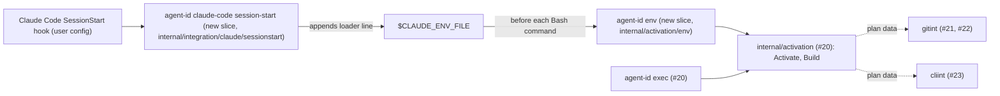

# agent-id env and the Claude Code SessionStart hook

Issue: #26 (E02-S12). Implemented by #26 after #21, #22 and #23. Depends on the child environment contract of #20.

Extends: `.ai/specs/2026-11-13-exec-child-environment.md` (it renders the same child environment as shell text; the activation pipeline and the builder stay there).
Extends: `.ai/specs/2026-11-12-profile-config.md` (explicit `--profile`; no `integrations` section in the config).

## 📝 TLDR

A developer who starts Claude Code with plain `claude` wants its Bash commands to run as the agent's bot. Today the only planned way is `agent-id exec --profile claude -- claude`. This spec proposes two commands. `agent-id env --profile <name> --shell bash|zsh` prints the child environment of #20 as shell text with no secret in it. `agent-id claude-code session-start --profile <name>`, run from a Claude Code `SessionStart` hook, appends one loader line to `CLAUDE_ENV_FILE`. Claude Code runs that line before every Bash command. It calls `agent-id env` against the command's live environment and stops the command with exit 125 when activation fails. Explicit `exec` stays the canonical activation, and the hook is the convenience layer (brief §7.3).

## 📝 Problem Statement

- Brief §8 *Claude Code integration* is P0, and the north star (§15) is "launch Claude Code in an existing repository … as its own bot". Developers launch `claude` from IDEs, shell aliases and desktop shortcuts. Requiring `agent-id exec` in front of every launch is the friction the integration removes.
- Claude Code runs every Bash command as a separate process. It applies a snapshot of the user's shell startup files (`~/.zshrc`, `~/.bashrc` or `~/.profile`) and runs the contents of `CLAUDE_ENV_FILE` as shell code before the command ([hooks, "Persist environment variables"](https://code.claude.com/docs/en/hooks.md); [tools reference, "Bash tool behavior"](https://code.claude.com/docs/en/tools-reference.md)). An environment computed once at session start can therefore drift from the environment a command actually runs in, for example when a startup file prepends a directory with another `gh` or sets `GH_TOKEN`.
- A hook that fails, or a binary that is missing, must not leave the session quietly in personal mode. That would be the silent fallback that brief §5 and §8 forbid.
- The emitted text is a shared contract (`SDLC.md`, risk inference: "the environment that `exec` and `env` emit"). Users will also `eval` it in their own terminals, and it can be traced with `set -x`, so it must never contain a token (`ARCHITECTURE.md`, Security model).
- Brief §7.3 requires tests for session startup, resume and nested execution.

## 📝 Proposed Solution

1. **`agent-id env --profile <name> --shell bash|zsh`.** It runs the same activation pipeline as `exec` (#20): resolve, readiness, inherited context, inherited Git checks, preflight, `Build`. The parent environment is the environment of the `agent-id env` process itself. With `Mechanism=env`, it prints the difference between that environment and the child environment as `unset` and `export` statements. Exit 0 with the text on stdout, or 125 with one error line on stderr and nothing on stdout. It writes no file and opens no network connection.
2. **`agent-id claude-code session-start --profile <name>`.** Run as a `SessionStart` command hook, it appends the **loader line** to `$CLAUDE_ENV_FILE` unless the file already contains that exact line. The loader line names the absolute agent-id binary and the profile. When Claude Code runs it before a Bash command, it executes `agent-id env` for that shell's live environment and `eval`s the result. If `agent-id env` fails, the loader prints the error and `exit 125`s, so the command does not run.
3. **Fail closed on the hook path.** If `session-start` itself cannot do its job (no `CLAUDE_ENV_FILE`, an invalid profile, a damaged context), it appends a **refusal line** instead of the loader and exits 1. Every Bash command of the session then stops with exit 125 and a message naming the cause. The documented hook command also appends a refusal line when the `agent-id` binary cannot be started at all (`|| …`, see Hook configuration).
4. **Hook configuration is documented, never installed.** agent-id does not write `.claude/settings.json`, `.claude/settings.local.json` or `~/.claude/settings.json` (issue scope: never the user's global settings without consent; `AGENTS.md`, Never). The integration docs in `internal/integration/claude/README.md` give the snippet, and the developer pastes it. The recommended location is `.claude/settings.local.json` of the repository (OQ1).
5. **Nesting.** A Bash command in an activated session that runs `agent-id exec --profile claude -- …` re-enters idempotently (#20). With another profile, it is refused, with an error that names both profiles. A loader line that runs twice gives the same environment, because `Build` is idempotent.

### Why a loader line rather than the rendered exports

| Option | For | Against | Verdict |
|---|---|---|---|
| **Loader line: the hook writes one line that runs `agent-id env` before each command** | Computed against the environment the command really gets, after the startup-file snapshot. `PATH`, inherited `GIT_CONFIG_*` and inherited tokens are handled exactly as in `exec`. A refreshed identity in the config applies from the next command. Activation failure stops each command (fail closed). One code path with `exec`. | Starts agent-id once per Bash command, which is about the cost of one Go process start plus a 64 KiB config read. The binary must stay at its path for the whole session. | **Chosen** |
| Rendered exports: the hook writes the `export` lines once | No process per command. | Values are frozen at session start against the hook's environment. A startup file that prepends a `PATH` directory or sets `GH_TOKEN` runs before the file and is either overwritten (the user's `PATH` is lost) or wins (`GH_TOKEN` from `~/.zshrc` reaches `gh` when the snapshot comes after). An activation error at the start leaves nothing to stop later commands. | Rejected |
| settings.json `env` block | Native to Claude Code. | Values are static strings with no shell expansion and no `unset`, so there is no way to remove an inherited `GH_TOKEN`. agent-id would have to write the user's settings. | Rejected |
| Only `agent-id exec -- claude` | Already designed (#20). | Does not cover launches that the developer does not control (IDE, desktop). This is the gap the brief names. | Kept as the canonical path; the hook is added |

Comparable tools: `direnv` exports its diff through a hook that runs before every prompt, and `mise`/`asdf` do the same. agent-id adopts the "recompute per command" model for the same reason: the shell's environment changes under it.

## 📝 Delta

### Capability: env

#### ADDED Requirement: Render the child environment as shell text
The system SHALL print, for the profile and the environment of the `agent-id env` process, `unset` and `export` statements that turn that environment into the child environment of #20 with `AGENT_ID_MECHANISM=env`, quoted so that `bash` and `zsh` evaluate every value literally.

##### Scenario: Eval equals exec
- WHEN a test evaluates `agent-id env --profile claude --shell bash` in `bash` and prints `env`, and separately runs `agent-id exec --profile claude -- env` from the same parent environment
- THEN both outputs are equal except for `AGENT_ID_MECHANISM` (`env` vs `exec`) and the shell's own variables (`PWD`, `SHLVL`, `_`)

##### Scenario: Hostile values stay literal
- WHEN the parent `PATH` contains a directory named `$(touch pwned)'"; \n` and the profile adds a `PATH` directory
- THEN evaluating the output in `bash` and in `zsh` creates no file and yields the exact `PATH` that `Build` computed

##### Scenario: No secret
- WHEN the parent has a fake `GH_TOKEN` and the output is scanned for every registered token prefix, `-----BEGIN`, and a JWT shape
- THEN nothing matches, and the output contains `unset GH_TOKEN`

##### Scenario: Unsupported shell
- WHEN `--shell fish` is passed
- THEN the exit status is 125, stdout is empty, and the message lists `bash` and `zsh`

#### ADDED Requirement: Same failure rules as exec
The system SHALL refuse with exit 125 and empty stdout for every error that makes `exec` exit 125, including a nested start with a different profile.

##### Scenario: Different profile inside a session
- WHEN `agent-id env --profile reviewer --shell zsh` runs where `AGENT_ID_ACTIVE_PROFILE=claude` and `AGENT_ID_CONTEXT=1`
- THEN the exit status is 125, stdout is empty, and stderr names both profiles

### Capability: claude-code-session-start

#### ADDED Requirement: Append the loader once
The system SHALL append exactly one loader line for the profile to `$CLAUDE_ENV_FILE`, SHALL NOT append it again when the file already contains that exact line, and SHALL NOT modify any other line of the file.

##### Scenario: Startup then resume
- WHEN `session-start` runs with `{"source":"startup"}` and again with `{"source":"resume"}` on the same `CLAUDE_ENV_FILE` that holds a line written by another hook
- THEN the file holds the other hook's line unchanged and exactly one loader line

##### Scenario: Commands run as the bot
- WHEN a simulated session sources the file and runs `git commit` and `git push` against the local Git server of `internal/testenv`, and `gh api repos/o/r` against a fake `gh`
- THEN the commit author and committer are the bot, the server records the fake installation token, and the fake `gh` sees the fake App token and no personal token

#### ADDED Requirement: Fail closed when activation fails
The system SHALL make every Bash command that runs after the env file stop with exit status 125 when activation cannot be established. This covers a failed `agent-id env` at command time and a failed `session-start` at session start.

##### Scenario: Profile removed mid-session
- WHEN the profile is deleted from the config after `session-start` succeeded, and a simulated command `sh -c '. "$CLAUDE_ENV_FILE"; echo ran'` runs
- THEN the output does not contain `ran`, the exit status is 125, and stderr contains agent-id's message

##### Scenario: Hook cannot activate
- WHEN `session-start` runs for a profile without a resolved identity
- THEN it appends a refusal line, exits 1, and a simulated command stops with 125 and the `setup` hint

##### Scenario: No CLAUDE_ENV_FILE
- WHEN `session-start` runs without `CLAUDE_ENV_FILE`
- THEN it exits 1 with a message that the hook must run as a Claude Code `SessionStart` command hook, and it writes no file

#### ADDED Requirement: Nested exec inside a session
The system SHALL keep the bot identity unchanged and SHALL NOT duplicate any `GIT_CONFIG_*` entry or `PATH` element when `agent-id exec` with the same profile runs inside an activated session.

##### Scenario: Same profile nested
- WHEN a simulated command runs `agent-id exec --profile claude -- env` after the loader
- THEN `GIT_CONFIG_COUNT` and every `GIT_CONFIG_*` entry equal those of the loader's environment, and the shim directory appears once in `PATH`

## 📝 Architecture



The hook only writes one line. Every activation, including the per-command one, goes through the same `internal/activation` pipeline as `exec`.

- **`internal/activation`** (#20) exposes the activation pipeline as the root-package function `Activate(ctx, d Deps, profile, mechanism string, parent []string) ([]string, error)`: read the context and decide nesting, resolve, readiness, inherited Git checks, preflight, `Build`. Both slices call it (dependency rule 2: a slice never imports another slice). This spec adds `Render(parent, child []string, shell string) (string, error)`, a pure function that produces the statements.
- **`internal/activation/env`** (new slice): `contract.go` (`Input{Profile, Shell string}`), `handler.go` (`Activate` with `Mechanism=env`, then `Render`), `command.go` (required `--profile` and `--shell`), `handler_test.go`.
- **`internal/integration/claude`** (new module): root package with the pure functions `LoaderLine(bin, profile, shell string) (string, error)` and `RefusalLine(reason string) string`, plus `README.md`, the integration docs with the hook snippet. Slice `internal/integration/claude/sessionstart`: `Input{Profile string; HookInput []byte; EnvFile string; Shell string}`. The handler validates, runs `Activate` once as a dry run to fail early, and appends the loader or the refusal line under an exclusive lock on the file. It imports `internal/activation` (root) and `internal/profile`; it names no forge.
- **`cmd/agent-id`** registers both commands. `env` and `session-start` use the exit-code error type of #20 (125 for `env`; 1 for `session-start`, because Claude Code treats any non-zero, non-2 status of a `SessionStart` hook as a non-blocking error and shows it to the user).
- **No new dependency.** The hook input is JSON on stdin, decoded with `encoding/json` and only for validation. agent-id acts on nothing in it except that `source` must be one of the documented values.

## 📝 API Contracts

### `agent-id env`

```text
agent-id env --profile <name> --shell bash|zsh
```

| Status | stdout | stderr |
|---|---|---|
| 0 | the statements below | nothing |
| 125 | nothing | `agent-id: env: <message>`, with the same messages as `exec` (#20, Errors) plus `unsupported shell "<v>"; use bash or zsh` |

Output format, contract version 1. The text is identical for `bash` and `zsh` in v1. `--shell` is required so that a later shell (for example `fish`) can get its own syntax without a breaking change.

```sh
# agent-id env 1 profile=claude
unset GH_TOKEN GITHUB_TOKEN
export AGENT_ID_ACTIVE_PROFILE='claude'
export AGENT_ID_BIN='/opt/homebrew/bin/agent-id'
export AGENT_ID_CONTEXT='1'
export AGENT_ID_GIT_CONFIG_BASE='0'
export AGENT_ID_MECHANISM='env'
export GIT_AUTHOR_EMAIL='12345678+claude-dev[bot]@users.noreply.github.com'
export GIT_CONFIG_COUNT='15'
export GIT_CONFIG_KEY_0='credential.https://github.com.helper'
export GIT_CONFIG_VALUE_0=''
export PATH='/Users/dev/.cache/agent-id/shim:/opt/homebrew/bin:/usr/bin:/bin'
```

(Values are illustrative. The lines come from #20's `Build` plus #21–#23's plan data.)

Rules of `Render`, each a table test:

- The first line is the comment `# agent-id env 1 profile=<name>`. The profile name pattern is shell-safe (profile spec).
- Then one `unset` statement listing, in name order, every variable that is in the parent but not in the child. The statement is omitted when that list is empty.
- Then one `export NAME='value'` per variable whose value differs or is new, in name order.
- Names must match `^[A-Za-z_][A-Za-z0-9_]*$`. A name that does not match fails the render (`ErrUnrenderable`) and is never printed.
- Values are single-quoted, and every `'` becomes `'\''`. Single quotes are literal in `bash` and `zsh` for every byte except NUL. A newline inside the quotes is literal too, and an environment value cannot contain NUL.
- Variables that are equal in the parent and the child are not printed. The output is a diff, so evaluating it twice is a no-op the second time.
- No token: the child comes from `Build`, which rejects token material (#20). `Render` runs the same scan over the text it produces as defense in depth and fails with `ErrUnrenderable` rather than print a match.

### `agent-id claude-code session-start`

```text
agent-id claude-code session-start --profile <name>
```

Inputs: the hook JSON on stdin (at most 64 KiB), `CLAUDE_ENV_FILE`, `SHELL`, and the profile.

| Step | Rule | On failure |
|---|---|---|
| 1 | `CLAUDE_ENV_FILE` is set, absolute, and its directory exists. If the file exists, it is a regular file owned by the current user and not writable by group or others. | Exit 1, message on stderr. No write, because there is no safe place to write the refusal. |
| 2 | stdin is valid JSON with `hook_event_name: "SessionStart"` and `source` one of `startup`, `resume`, `clear`, `compact`, `fork` | Refusal line, exit 1 |
| 3 | The shell is `basename($SHELL)` and must be `bash` or `zsh`. Claude Code's Bash tool uses the user's shell. | Refusal line, exit 1 |
| 4 | `Activate` succeeds for the profile (dry run, environment discarded) | Refusal line with the activation message, exit 1 |
| 5 | Under an exclusive `flock` on `CLAUDE_ENV_FILE`, append the loader line unless the file already contains it byte for byte. The file is created with mode `0600` if absent. | Exit 1 |
| — | Success: exit 0, nothing on stdout. Claude Code adds a `SessionStart` hook's stdout to Claude's context, and agent-id adds nothing there. | |

**Loader line** (one line, `<bin>` and `<profile>` single-quoted as in `Render`, `<shell>` is `bash` or `zsh`):

```sh
__agent_id_env=$('<bin>' env --profile '<profile>' --shell <shell>) || { printf '%s\n' 'agent-id: agent activation failed; the command was not run' >&2; exit 125; }; eval "$__agent_id_env"; unset __agent_id_env # agent-id loader 1
```

- `<bin>` is `AGENT_ID_BIN` resolution from #20 (the stable symlink when possible). A path that cannot be single-quoted safely (control characters, newline) fails step 4.
- `agent-id env` writes its own error line to stderr before the loader's line, so the user and Claude see the cause.
- `exit 125` ends the shell that Claude Code runs for the command, before the command itself runs. Claude Code runs the env file's contents "as shell code before the command itself" in the same shell (hooks docs). The end-to-end story #27 confirms this on a real Claude Code session, and the docs name it as an assumption until then.

**Refusal line**:

```sh
printf '%s\n' 'agent-id: <reason>; the command was not run. Fix it and start a new session (agent-id doctor --profile <profile>)' >&2; exit 125 # agent-id refusal 1
```

`<reason>` is agent-id's error message. It is cut to 200 characters, control characters are replaced with `?`, and it is single-quoted, so the message can never inject shell code.

### Hook configuration (documented in `internal/integration/claude/README.md`)

```json
{
  "hooks": {
    "SessionStart": [
      {
        "hooks": [
          {
            "type": "command",
            "command": "agent-id claude-code session-start --profile claude || printf '%s\\n' \"printf '%s\\\\n' 'agent-id: the SessionStart hook could not run agent-id; the command was not run' >&2; exit 125\" >> \"$CLAUDE_ENV_FILE\""
          }
        ]
      }
    ]
  }
}
```

- No `matcher`, so the hook runs for every `source` (`startup`, `resume`, `clear`, `compact`, `fork`). The `||` branch covers a missing binary or a crash before agent-id could write its own refusal line. The README carries a golden test of the exact snippet (step 9).
- Location: `.claude/settings.local.json` of the repository, which is personal and not committed (OQ1). A team that standardizes on agent-id may commit it to `.claude/settings.json`, and the README explains the consequence: every collaborator's Bash commands then require agent-id and the profile.
- Workspace trust: in interactive use, Claude Code runs no hook from any settings file until the user accepts the folder's trust dialog. With `-p` or the SDK, hooks from a repository's `.claude/settings.json` run in a folder that has never been trusted ([hooks, "Workspace trust"](https://code.claude.com/docs/en/hooks.md)). Until trust is accepted, the session is personal and unmanaged. `agent-id whoami` (#24) shows `personal/unmanaged` there. The README states this.
- agent-id never edits any of these files. A future `agent-id claude-code install` command would need the owner's decision (OQ3).

## 📝 Edge Cases & Failure Scenarios

| Situation | What the user sees |
|---|---|
| `agent-id` not on the `PATH` of the hook | The `||` branch appends its refusal line. Every Bash command prints "the SessionStart hook could not run agent-id" and exits 125. |
| The agent-id binary is upgraded during the session | The loader uses the stable symlink, so it keeps working. If the path disappears, commands stop with 125 (the shell's "not found" plus the loader's message). |
| The config changes during the session (identity refreshed by `doctor`) | The next command picks it up, because the loader recomputes. |
| The profile is deleted or broken during the session | Every later command stops with 125 and the store's message. |
| A startup file prepends a directory with another `gh` | `Build` removes the shim directory and prepends it again, so the shim is first. |
| A startup file exports `GH_TOKEN` | The loader runs after the snapshot, and the `unset` removes the token. If Claude Code runs the snapshot after the env file instead, it is a documented bypass (local mode is not a sandbox). `doctor` D6 run inside the session detects it. |
| Two hooks configure different profiles | The second loader fails with the nested-profile error, and every command stops with 125, naming both profiles. |
| The same hook configured in both user and project settings | Each run appends only if the exact line is absent, so the file gets one loader line. |
| `clear`, `compact`, `fork` | The hook runs again. The loader line is idempotent, or a new env file gets one line. |
| A Bash command runs `agent-id exec --profile claude -- …` | Re-entry, with no duplicates. |
| A Bash command runs `env -i …` or `unset AGENT_ID_CONTEXT` | A documented bypass (brief §10). |
| MCP servers and subagents started by Claude Code | Not covered. Claude Code applies `CLAUDE_ENV_FILE` to Bash commands, and the docs say nothing about MCP servers. For those, the README recommends `agent-id exec -- claude`. |
| Hook input larger than 64 KiB or not JSON | Refusal line, exit 1. |
| Windows, PowerShell hooks | Not supported (brief §8). `CLAUDE_ENV_FILE` is not provided to PowerShell hooks (hooks docs). |

## 📝 Risks & Impact Review

- **Contract.** The `env` output format (version comment, `unset`, single-quoted exports), the loader line and its marker comment, the refusal line, and the command name `claude-code session-start` are consumed by users' hook configuration and scripts. A change needs a new contract version in the comment and a README migration note.
- **Per-command cost.** One agent-id start per Bash command, an estimated 5–15 ms on the owner's machine. Step 8 measures it and records it in the README. If it proves too slow, the fallback is a cached render keyed on the parent environment's hash, without a contract change.
- **Assumption about Claude Code.** The design relies on two documented behaviors: the env file runs in the same shell before the command, and `SessionStart` provides `CLAUDE_ENV_FILE`. It also relies on one inferred behavior: `exit` in the env file prevents the command. #27 verifies all three on a real session. If `exit` does not stop the command, the loader still leaves the command with no agent context and an unparseable `GIT_CONFIG_COUNT=x` would be the fallback guard. That alternative is noted, not designed here.
- **Not a security boundary** (brief §10). Claude can run commands that unset the variables or call another binary. Hooks run only after workspace trust in interactive use.
- **Team-wide hooks** (OQ1) make agent-id mandatory for every collaborator's Claude session in that repository. The recommendation keeps it personal.
- **Product direction vs. rule.** The loader approach, the render format and the command names are technical decisions of this spec. OQ1–OQ3 are product choices recorded with a recommendation.

## 📝 Decisions in play

- Brief §7.3 (explicit `exec` canonical, `env` a convenience, tested for startup, resume and nesting), §8 *Claude Code integration*, §10, §14 *Profile selection* (explicit only: the hook passes `--profile`, and there is no auto-detection, which #29 decides).
- `ARCHITECTURE.md`: Key decisions (explicit `exec` canonical; `env` and `SessionStart` a convenience layer), Security model (no secret in generated scripts or under `set -x`).
- `.ai/specs/2026-11-13-exec-child-environment.md`: the child environment contract, nesting, exit codes, `AGENT_ID_BIN`.
- Profile spec: no `integrations` section, and the hook carries `--profile`.

## Open Questions (owner) — recommendations applied

| # | Question | Recommendation (applied) | Why | Confirm? |
|---|---|---|---|---|
| OQ1 | Where should the documented hook live by default: `.claude/settings.local.json` (personal, not committed) or the committed `.claude/settings.json` (team-wide)? | **`.claude/settings.local.json`**. A team can commit it once every collaborator uses agent-id. | A committed hook makes every collaborator's Bash commands fail closed without agent-id and the same profile name. | owner, non-blocking |
| OQ2 | When activation fails in a session, should Bash commands stop (exit 125) or run as the developer with a warning? | **Stop.** | Brief §5 and §8: fail rather than silently use the personal account. | owner, non-blocking |
| OQ3 | Should agent-id later offer `agent-id claude-code install` to write the hook into `.claude/settings.local.json` with the user's explicit consent? | **Not in the MVP.** Document the snippet only. | Issue scope, and `AGENTS.md`: never edit the user's configuration without consent. Can be added without breaking anything. | owner, non-blocking |

## Resolved assumptions (autonomous defaults)

| # | Question | Applied default | Why | Confirm? |
|---|---|---|---|---|
| A1 | What does the hook write? | A loader line that runs `agent-id env` before each command, not frozen exports. | It matches the environment the command really gets, and it fails closed for each command. | reversible |
| A2 | `env` output format | Version comment, then `unset`, then single-quoted `export` statements as a sorted diff. Identical for `bash` and `zsh` in v1. | Literal quoting is safe in both shells, and a diff is idempotent. | reversible before the first release |
| A3 | Command name of the hook handler | `agent-id claude-code session-start`. | Names the integration and the event. Room for `claude-code` subcommands later. | reversible before the first release |
| A4 | Exit status of `session-start` on failure | 1, after writing a refusal line. | Claude Code shows a non-blocking hook error to the user, and the refusal line enforces fail closed. | reversible |
| A5 | Shell detection | `basename($SHELL)`, only `bash` or `zsh`. | The Bash tool uses the user's shell. | reversible |
| A6 | Where the shared pipeline lives | `internal/activation.Activate`, which both slices call. | Dependency rule 2: a slice never imports another slice. | reversible |

## 📋 Phasing

- **Phase 1 — `agent-id env`.** `Render` and the slice. Needs #20 (`Activate`, `Build`). Useful on its own (`eval "$(agent-id env --profile claude --shell zsh)"`).
- **Phase 2 — `claude-code session-start` and docs.** Needs Phase 1. The "git and gh use the bot" acceptance test needs #21, #22 and #23 merged.
- **Phase 3 — record.** `ARCHITECTURE.md` and the capability archive.

## 📋 Implementation Plan

Every test calls `testenv.Isolate(t)` first, and packages that run Git or `gh` use `testenv.Main`. `risk-high` evidence per `SDLC.md`: hostile-input tables, process tests with a decoy personal token and a decoy credential helper that record zero uses, and a scan of every output for token material.

### Phase 1 — `agent-id env`

1. **`Render`** in `internal/activation`. Table tests: empty diff, `unset` only, `export` only, sorted order, single quotes and `'\''`, a newline in a value, `$(…)`, backquotes, `\`, `!`, `%`, non-ASCII bytes, an invalid name → `ErrUnrenderable`, and a value with a registered token prefix → `ErrUnrenderable` without the value in the error. Round-trip test: evaluate the output in `bash` and in `zsh` (skip a shell that is not installed) and compare the resulting environment with the child.
2. **Slice `internal/activation/env`.** Contract, handler (`Activate` with `Mechanism=env`, then `Render`), command (required `--profile`, `--shell` in `bash|zsh`). Handler tests with the fakes of #20: every error row → 125, empty stdout. Eval-equals-exec test with `testenv.BuildBinary`.

### Phase 2 — Claude Code integration

3. **`internal/integration/claude` root.** `LoaderLine`, `RefusalLine`, and their `AGENTS.md` (invariants: never edit Claude settings; never write anything but the loader or the refusal line; no forge names). Tables: hostile binary paths (space, `'`, newline → error), profile names, a reason with quotes and escape sequences cut and quoted.
4. **Slice `sessionstart`.** Steps 1–5 of the table. Tests: no `CLAUDE_ENV_FILE`; a relative path; a file owned by group-write mode `0664`; a symlink to another user's file (refused); bad JSON; an unknown `source`; `SHELL=/bin/fish`; activation failure → refusal line; startup then resume → one loader line, other lines preserved; two concurrent runs → one line (`flock`).
5. **Simulated session, process test.** Build the binary, write a fixture config, and set a decoy personal `GH_TOKEN` and a decoy global credential helper that records calls. Run `session-start` with `{"source":"startup"}`. For each command, run `bash -c '. "$CLAUDE_ENV_FILE"; <command>'` and `zsh -c …` in the same way: `git commit` (bot author and committer), `git push` to `testenv.NewGitServer` (records the fake installation token, and the decoy helper records zero calls), a fake `gh` that prints a hash of its `GH_TOKEN` (the App token's hash, never the decoy's), `agent-id exec --profile claude -- env` (no duplicates), and `agent-id exec --profile reviewer -- true` (125, both names). Then run `{"source":"resume"}` and repeat one command.
6. **Fail-closed process tests.** Profile deleted mid-session → 125 and the command did not run. Profile without identity → refusal line → 125. The documented hook command run with `PATH` lacking agent-id → its refusal line → 125.
7. **Token scan.** Every stdout, stderr and env file content of steps 5–6 is scanned for `ghs_`, `ghp_`, `github_pat_`, `-----BEGIN`, and a JWT shape. Nothing matches.
8. **Cost measurement.** A benchmark of the loader line (`bash -c '. file; true'`) on the CI runner and the owner's machine, recorded in the README.
9. **README.** The integration docs: snippet, location (OQ1), trust behavior, coverage (Bash only; MCP servers through `exec`), troubleshooting with `whoami` and `doctor`, and the honest-claims sentence (local mode is not a sandbox). A golden test keeps the snippet in sync with `LoaderLine` and `RefusalLine`.

### Phase 3 — record

10. **Architecture and archive.** Add the module `internal/integration/claude` to the component table and its dependency (`→ internal/activation`, `→ internal/profile`) to Key decisions in `ARCHITECTURE.md`. Archive the Delta into `.ai/specs/capabilities/env.md` and `.ai/specs/capabilities/claude-code-session-start.md`.
