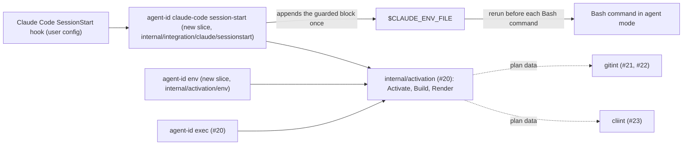

# agent-id env and the Claude Code SessionStart hook

Issue: #26 (E02-S12). Implemented by #26 after #21, #22 and #23. Depends on the child environment contract of #20.

Extends: `.ai/specs/2026-11-13-exec-child-environment.md` (it renders the same child environment as shell text; the activation pipeline and the builder stay there).
Supersedes: `.ai/specs/2026-11-13-exec-child-environment.md` — sections: Architecture (the `Activate` return type and the new `Plan.Unshadow` field)
Extends: `.ai/specs/2026-11-12-profile-config.md` (explicit `--profile`; no `integrations` section in the config).

## 📝 TLDR

A developer who starts Claude Code with plain `claude` wants its Bash commands to run as the agent's bot. Today the only planned way is `agent-id exec --profile claude -- claude`.

This spec proposes two commands:

- `agent-id env --profile <name> --shell bash|zsh` prints the child environment of #20 as one shell block that succeeds or fails as a whole. It contains no secret.
- `agent-id claude-code session-start --profile <name>` runs from a Claude Code `SessionStart` hook. It appends that block to `CLAUDE_ENV_FILE` once, or appends a refusal line when activation fails.

Claude Code runs the file's contents before every Bash command, so each command either starts in agent mode or does not start at all (exit 125). Explicit `exec` stays the canonical activation, and the hook is the convenience layer (brief §7.3).

## 📝 Problem Statement

- Brief §8 *Claude Code integration* is P0. The north star (§15) is "launch Claude Code in an existing repository … as its own bot". Developers launch `claude` from IDEs, shell aliases, and desktop shortcuts. Requiring `agent-id exec` in front of every launch is the friction the integration removes.
- Facts from the Claude Code docs ([hooks](https://code.claude.com/docs/en/hooks.md), [tools reference](https://code.claude.com/docs/en/tools-reference.md), read 2026-11-13):
  - `SessionStart` hooks receive `CLAUDE_ENV_FILE`.
  - "Each Bash command runs the file's contents as shell code before the command itself."
  - Each Bash command is a separate process.
  - At session start, Claude Code sources `~/.zshrc`, `~/.bashrc`, or `~/.profile`, captures aliases, functions, and shell options, and applies them to every command.
- A hook that fails, or a binary that is missing, must not leave the session quietly in personal mode. That would be the silent fallback that brief §5 and §8 forbid.
- The emitted text is a shared contract (`SDLC.md`, risk inference). Users also `eval` it in their own terminals, and `set -x` can trace it, so it must never contain a token (`ARCHITECTURE.md`, Security model).
- Brief §7.3 requires tests for session startup, resume, and nested execution.

## 📝 Proposed Solution

1. **`agent-id env --profile <name> --shell bash|zsh`.**
   - It runs the activation pipeline of #20, `activation.Activate`, with `Mechanism=env`. The parent environment is the environment of the `agent-id env` process.
   - It prints the result as one **activation block** (`Render`, below), with every statement chained with `&&` so that the block succeeds or fails as a whole.
   - On success it exits 0 with the block on stdout. On failure it exits 125, writes one error line to stderr, and writes nothing to stdout.
   - It opens no network connection. Like `exec`, it may create agent-id's own neutral directories under `<cache>/agent-id/<provider>/` (amended by #68, see the exec spec); it writes nothing else.
2. **`agent-id claude-code session-start --profile <name>`.** This is a `SessionStart` command hook.
   - It runs the same pipeline once. The working directory for preflight is the hook input's `cwd`, so O1 runs there once per session start.
   - It renders the block and wraps it as `{ <block>; } || { <refusal>; exit 125; }`.
   - It appends the result to `$CLAUDE_ENV_FILE`, unless an identical guarded block is already there.

   Claude Code reruns the file before every command, so the block re-applies the same environment to each fresh command process. If one statement fails, for example because a startup file made `GH_TOKEN` read-only, the command does not run.
3. **Fail closed on the hook path.**
   - If the pipeline fails, `session-start` appends a **refusal line** instead and exits 3. Every Bash command of the session then stops with exit 125 and the reason. The pipeline fails on an invalid profile, an unresolved identity, a nested context, a refused SSH remote, or a damaged context.
   - The documented hook command appends its own refusal line only when agent-id could not run at all: any status other than 0, 3 or 4: a usage error, an older agent-id without the command, not found, not executable, or a crash.
4. **Later failures are caught where credentials are used.** The block carries no token. If the profile breaks during the session, the credential helper (#22) and the `gh` shim (#23) fail closed at use, as they do under `exec`.
5. **Shadowing aliases and functions.** In the command's shell, the block removes any function, and on a best-effort basis any alias, named `git` or named after the provider's CLI (`gh`), using `unalias` and `unset -f`.
   - Claude Code applies the aliases and functions of the startup-file snapshot to every command (docs).
   - Such a wrapper could inject another token (gh analysis; Git analysis R9–R10).
6. **Hook configuration is documented, never installed.**
   - agent-id does not write `.claude/settings.json`, `.claude/settings.local.json`, or `~/.claude/settings.json`. Editing the user's configuration is outside the issue's scope and is forbidden by `AGENTS.md` (Never).
   - `internal/integration/claude/README.md` gives the snippet. The recommended location is `.claude/settings.local.json` (OQ1).
7. **Nesting.**
   - A Bash command that runs `agent-id exec --profile claude -- …` re-enters idempotently (#20).
   - With another profile, it is refused with an error that names both profiles.

### Why a static block rather than a per-command recomputation

| Option | For | Against | Verdict |
|---|---|---|---|
| **Static block written once at session start; Claude Code reruns it before each command** | No process start per command. No dependency on the binary path in the env file. Preflight runs once, in the session's directory. Same text that `agent-id env` prints for terminals. Fails as a whole. | The block is computed against the hook's environment. If a command's environment differed in a way the block does not override, nothing recomputes it. `doctor` D6, run inside the session, detects that. | **Chosen** |
| Loader line that runs `agent-id env` before each command (first draft) | Always computed against the live environment. | One agent-id start plus preflight (`git`) per command. A `cd` into a repository with an uncovered SSH remote would break every later command. The docs give no evidence that a command's environment differs from Claude Code's own. | Rejected (review of PR #51, M4, M5) |
| settings.json `env` block | Native to Claude Code. | Static strings with no `unset`: an inherited `GH_TOKEN` cannot be removed. agent-id would also have to write the user's settings. | Rejected |
| Only `agent-id exec -- claude` | Already designed (#20). | Does not cover launches the developer does not control (IDE, desktop): the gap the brief names. | Kept as the canonical path; the hook is added |

## 📝 Delta

### Capability: env

#### ADDED Requirement: Render the child environment as one shell block
The system SHALL print one block of `unset`, `unalias`/`unset -f`, and `export` statements chained with `&&`, computed for the profile and the environment of the `agent-id env` process. When evaluated in `bash` or `zsh`, the block SHALL turn that environment into the child environment of #20 with `AGENT_ID_MECHANISM=env`, and every value SHALL be quoted literally.

##### Scenario: Eval equals exec
- WHEN a test evaluates `agent-id env --profile claude --shell bash` in `bash` and prints `env`, and separately runs `agent-id exec --profile claude -- env` from the same parent environment
- THEN both outputs are equal except for `AGENT_ID_MECHANISM` (`env` vs `exec`) and the shell's own variables (`PWD`, `SHLVL`, `_`)

##### Scenario: Hostile values stay literal
- WHEN the parent `PATH` contains a directory named `$(touch pwned)'"; \n` and the plan prepends a directory
- THEN evaluating the block in `bash` and in `zsh` creates no file, and `PATH` equals the value that `Build` computed

##### Scenario: The block fails as a whole
- WHEN `GH_TOKEN` is read-only in the shell (`readonly GH_TOKEN`) and the block is evaluated as `eval "$block" || echo failed`
- THEN `failed` is printed in `bash`; in `zsh`, the read-only error aborts the shell with status 1 before the guard runs, so the command still does not run, and zsh's own message names the variable

##### Scenario: No secret
- WHEN the parent has a fake `GH_TOKEN` and the output is scanned for every registered token prefix, `-----BEGIN`, and a JWT shape
- THEN nothing matches, and the output contains `unset GH_TOKEN`

##### Scenario: Unsupported shell
- WHEN `--shell fish` is passed
- THEN the exit status is 125, stdout is empty, and the message lists `bash` and `zsh`

#### ADDED Requirement: Same failure rules as exec
The system SHALL refuse with exit 125 and empty stdout for every error that makes `exec` exit 125, including a nested start with a different profile.

##### Scenario: Different profile inside a session
- WHEN `agent-id env --profile reviewer --shell zsh` runs where `AGENT_ID_ACTIVE_PROFILE=claude` and `AGENT_ID_CONTEXT=1`
- THEN the exit status is 125, stdout is empty, and stderr names both profiles

### Capability: claude-code-session-start

#### ADDED Requirement: Append the guarded block once
The system SHALL append exactly one guarded activation block for the profile to `$CLAUDE_ENV_FILE`. It SHALL NOT append it again when an identical guarded block is already in the file, and SHALL NOT modify any other line of the file.

##### Scenario: Startup then resume
- WHEN `session-start` runs with `{"hook_event_name":"SessionStart","source":"startup"}`, and again with `"source":"resume"`, on the same `CLAUDE_ENV_FILE`, which holds a line written by another hook
- THEN the file holds the other hook's line unchanged and exactly one guarded block

##### Scenario: Commands run as the bot
- WHEN a simulated session runs commands as `bash -c '. "$CLAUDE_ENV_FILE"; <command>'`, and the same with `zsh -c`. The commands are `git commit`, `git push` to the local Git server of `internal/testenv`, and `gh api repos/o/r` through the `gh` shim against a fake `gh`
- THEN the commit author and committer are the bot, the server records the fake installation token, and the fake `gh` sees the fake App token and no personal token

#### ADDED Requirement: Fail closed when activation fails
The system SHALL make every Bash command that runs the env file stop with exit status 125 when activation could not be established at session start.

##### Scenario: Hook cannot activate
- WHEN `session-start` runs for a profile without a resolved identity
- THEN it appends a refusal line and exits 3; a simulated command `sh -c '. "$CLAUDE_ENV_FILE"; echo ran'` does not print `ran`, exits 125, and prints the `setup` hint

##### Scenario: Hostile profile name
- WHEN the hook runs `session-start --profile "a';x"`
- THEN the refusal line names no profile, evaluating it runs no injected code, and the command exits 125

##### Scenario: agent-id cannot run
- WHEN the documented hook command runs with a `PATH` that does not contain `agent-id`
- THEN its fallback appends a refusal line with the refusal marker, the hook exits 1 (any status other than 0, 3 or 4 from agent-id is treated the same, including an older agent-id without the command), and a simulated command exits 125

##### Scenario: Not run as a hook
- WHEN `session-start` runs without `CLAUDE_ENV_FILE`
- THEN it exits 4 with a message that it must run as a Claude Code `SessionStart` command hook, and it writes no file

#### ADDED Requirement: Shadowing aliases and functions are removed
The system SHALL remove, in each command's shell and before the command runs, any function named `git` or named after the provider's CLI, and SHALL attempt the same for aliases. An alias is removed reliably only when the env file and the command are parsed separately; `bash` expands an alias of a line that it has already parsed (assumption verified by #27).

##### Scenario: gh function from .zshrc
- WHEN the simulated command's shell defines `gh() { GH_TOKEN=decoy command gh "$@"; }` before running the env file, and then runs `gh api repos/o/r`
- THEN the fake `gh` sees the App token, never `decoy`

#### ADDED Requirement: Nested exec inside a session
The system SHALL keep the bot identity unchanged, and SHALL NOT duplicate any `GIT_CONFIG_*` entry or `PATH` element, when `agent-id exec` with the same profile runs inside an activated session.

##### Scenario: Same profile nested
- WHEN a simulated command runs `agent-id exec --profile claude -- env` after the env file
- THEN `GIT_CONFIG_COUNT` and every `GIT_CONFIG_*` entry equal those that the block set, and the shim directory appears once in `PATH`

## 📝 Architecture



Every activation goes through the same `internal/activation` pipeline as `exec`. The hook only adds the guard and the append.

- **`internal/activation`** (#20) exposes `Activate(ctx, d Deps, r Request) (Activation, error)`, with `Activation{Env, Drop, Unshadow []string}`. This changes the merged exec spec, where `Activate` returns only `[]string` (see the `Supersedes:` line): `exec` uses `Env`, and the renderers also need `Drop` and `Unshadow`. `Request` carries the profile, the mechanism, the binary path, the working directory, and the parent environment. This spec adds:
  - the plan field `Unshadow []string`: command names, contributed by `gitint` (`git`) and `cliint` (the provider's CLI name, `gh` in the MVP). It affects only rendering, because `exec` starts a program, not a shell;
  - `Render(parent []string, a Activation) (string, error)`, a pure function.

  Both slices and `session-start` call `Activate` and `Render` (dependency rule 2: a slice never imports another slice).
- **`internal/activation/env`** (new slice):
  - `contract.go`: `Input{Profile, Shell string}`;
  - `handler.go`: `Activate` with `Mechanism=env`, then `Render`;
  - `command.go`: `--profile` checked in the handler, `--shell` in `bash|zsh`, flag errors mapped to 125 as in #20;
  - `handler_test.go`.
- **`internal/integration/claude`** (new module).
  - Root package: the pure functions `GuardedBlock(block, refusal string) string` and `RefusalLine(reason, profile string) string`. `RefusalLine` names the profile only when the name matches the profile name rule. The root also holds `README.md`, the integration docs with the hook snippet.
  - Slice `internal/integration/claude/sessionstart`, with `Input{Profile string; HookInput []byte; EnvFile string}`. The handler validates the input, calls `Activate` with `Dir` set to the hook input's `cwd`, calls `Render`, and appends under a lock. It imports `internal/activation` (root) and names no forge.
- **`cmd/agent-id`** registers both commands.
  - `env` exits 125 on failure, as `exec` does.
  - `session-start` exits 0 on success, 3 when it wrote a refusal line, and 4 when it found no safe or parseable file to write (steps 1 and 5). These codes differ from cobra's 1, so the hook snippet can tell agent-id's own outcome from a usage error, an unknown command in an older agent-id, a missing binary, or a crash. Every non-zero code is shown to the user, because Claude Code treats any non-zero status other than 2 from a `SessionStart` hook as a non-blocking error and shows it to the user.
- **No new dependency.** The hook input is JSON on stdin, decoded with `encoding/json`.

## 📝 API Contracts

### `agent-id env`

```text
agent-id env --profile <name> --shell bash|zsh
```

| Status | stdout | stderr |
|---|---|---|
| 0 | the activation block | nothing |
| 125 | nothing | `agent-id: env: <message>`, with the same messages as `exec` (#20, Errors) plus `unsupported shell "<v>"; use bash or zsh` |

The format is contract version 1. The text is the same for `bash` and `zsh` in v1. `--shell` is required so that a later shell (for example `fish`) can get its own syntax without a breaking change. Example, with illustrative values:

```sh
# agent-id env 1 profile=claude
unset GH_TOKEN GITHUB_TOKEN &&
{ unalias gh git 2>/dev/null; unset -f gh git 2>/dev/null; true; } &&
export AGENT_ID_ACTIVE_PROFILE='claude' &&
export AGENT_ID_BIN='/opt/homebrew/bin/agent-id' &&
export AGENT_ID_CONTEXT='1' &&
export AGENT_ID_GIT_CONFIG_BASE='0' &&
export AGENT_ID_GIT_CONFIG_END='15' &&
export AGENT_ID_MECHANISM='env' &&
export GIT_AUTHOR_EMAIL='12345678+claude-dev[bot]@users.noreply.github.com' &&
export GIT_CONFIG_COUNT='15' &&
export GIT_CONFIG_KEY_0='credential.https://github.com.helper' &&
export GIT_CONFIG_VALUE_0='' &&
__agent_id_dir='/Users/dev/.cache/agent-id/shim' &&
__agent_id_path=":$PATH:" &&
while case $__agent_id_path in *":$__agent_id_dir:"*) true ;; *) false ;; esac; do __agent_id_path="${__agent_id_path%%":$__agent_id_dir:"*}:${__agent_id_path#*":$__agent_id_dir:"}"; done &&
__agent_id_path="${__agent_id_path#:}" && __agent_id_path="${__agent_id_path%:}" &&
export PATH="$__agent_id_dir${__agent_id_path:+:$__agent_id_path}" &&
unset __agent_id_path __agent_id_dir
```

Rules of `Render`, each a table test:

- **Order.** The block starts with the comment `# agent-id env 1 profile=<name>`; the profile name pattern is shell-safe (profile spec). It continues with:
  1. one `unset` of every name in `Drop` plus every variable that is in the parent but not in the child, in name order. The `Drop` names are always unset, even when absent from the parent, so a token that a startup file exported is removed too;
  2. the unshadow group for the plan's `Unshadow` names, which always succeeds;
  3. one `export NAME='value'` per variable other than `PATH` whose value differs or is new, in name order;
  4. the `PATH` group;
  5. `unset __agent_id_path __agent_id_dir`.

  Statements are joined with ` &&` and a newline.
- **`PATH`** is never written as a frozen absolute value.
  - For each of the plan's `PathPrepend` directories (in reverse order, so the first ends up first), the group puts the directory in a variable and removes every occurrence from the current `$PATH` with a `case`/`%%`/`#` loop, in which the variable is double-quoted inside the pattern, so `*`, `?`, `[`, spaces and `'` are matched literally. Then it prepends the directory. A `${var//pattern/repl}` form was rejected: inside double quotes, `bash` 3.2 keeps the single quotes of the pattern and mangles `PATH` (tried while writing this spec).
  - The loop was run on `bash` 3.2.57 and `zsh` 5.9 with a directory `/x *y/sh'im`. With `PATH` values containing that directory twice, empty, the directory alone, a look-alike directory, and no match, the result had the directory first and exactly once, every other element unchanged and in order, and a second run made no change.
  - Because the result is relative to the shell's own `$PATH`, a directory that the startup files add keeps its place after the shim. Evaluating the block twice does not duplicate the shim.
  - When the plan prepends nothing, the group is omitted.
- **Names.** Variable names must match `^[A-Za-z_][A-Za-z0-9_]*$`; a name that does not match fails the render (`ErrUnrenderable`) and is never printed. `Unshadow` names must match `^[a-z][a-z0-9-]*$`.
- **Values** are single-quoted, and every `'` becomes `'\''`. Single quotes are literal in `bash` and `zsh` (including with `RC_QUOTES`) for every byte, and an environment value cannot contain NUL.
- **Diff only.** Variables that are equal in the parent and the child are not printed.
- **No token.** The child comes from `Build`, which rejects token material (#20). `Render` runs the same scan over its own output as defense in depth, and fails with `ErrUnrenderable` rather than print a match.

### `agent-id claude-code session-start`

```text
agent-id claude-code session-start --profile <name>
```

Inputs: the hook JSON on stdin (at most 64 KiB), `CLAUDE_ENV_FILE`, and the profile.

| Step | Rule | On failure |
|---|---|---|
| 1 | `CLAUDE_ENV_FILE` is set and absolute. Open it with `O_RDWR\|O_APPEND\|O_CREAT\|O_NOFOLLOW`, mode `0600`, then `fstat` the same descriptor. It must be a regular file owned by the current user and not writable by others, and not group-writable unless its group is a user-private group: the group's name equals the user's name and it has no other members. Linux user-private groups with umask 002 create `0664` files; the macOS primary group `staff` is shared, so a group-writable file there is refused. Take an exclusive `flock` on that descriptor. A symlink is refused. | Exit 4 with the message on stderr, and no write: there is no safe file. The session stays personal, the hook error is shown, and `whoami` shows `personal/unmanaged`. This and an existing file that does not parse (step 5) are the two paths that do not fail closed, because there is no file agent-id can make fail. |
| 2 | stdin is valid JSON with `hook_event_name: "SessionStart"` and a string `cwd` that is an absolute path. `source` is not checked: an unknown future value must not block sessions. | Refusal line, exit 3 |
| 3 | If the file already contains a guarded block for another profile, refuse. | Refusal line naming both profiles, exit 3 |
| 4 | `Activate(Request{Profile, Mechanism: "env", Binary, Dir: cwd, Parent: os.Environ()})`, then `Render` | Refusal line with the activation message, exit 3 |
| 5 | Read the file through the same descriptor (`pread`) and check it with `<shell> -n` (parse only), where `<shell>` is `basename($SHELL)` when that is `bash` or `zsh`, and `bash` otherwise: the file must parse in the shell that will run it, and `dash -n` would reject valid `bash` lines from other hooks. If it does not parse, a syntax error from another hook would stop every later line, the guard included, so refuse. If an identical guarded block is present, write nothing. Otherwise append the guarded block with a single `write`, then check the whole file with `<shell> -n` again. A line that another hook appends between agent-id's write and this check can be cut by the rollback; that is the interleaved-write case of the edge-case table (documented bypass). | On a parse error in the existing content: exit 4, nothing written. On a failed or short write, or a parse error after the append: `ftruncate` to the previous size, append the refusal line (exit 3); exit 4 only if that fails too. |
| — | Success: exit 0, nothing on stdout. Claude Code adds a `SessionStart` hook's stdout to Claude's context, and agent-id adds nothing there. | |

**Guarded block**: the `Render` output, wrapped as follows.

```sh
# agent-id session-start 1 profile=claude
{
<block>
} || { printf '%s\n' 'agent-id: agent activation failed in this shell; the command was not run (agent-id doctor --profile claude)' >&2; exit 125; }
# agent-id session-start end
```

`exit 125` ends the shell that runs the env file, before the command itself runs. Variables from the env file can reach the command only if the file runs in the command's own shell, and in that case `exit` ends that shell. #27 confirms both on a real Claude Code session.

**Refusal line.** `<profile>` appears only when it matches the profile name rule. `<reason>` is agent-id's error message, cut to 200 characters, with control characters replaced by `?`, and single-quoted.

```sh
printf '%s\n' 'agent-id: <reason>; the command was not run. Fix it and start a new session (agent-id doctor --profile <profile>)' >&2; exit 125 # agent-id refusal 1
```

### Hook configuration (documented in `internal/integration/claude/README.md`)

The command, as a shell line:

```sh
agent-id claude-code session-start --profile claude; s=$?; case $s in 0|3|4) exit "$s" ;; esac; printf '%s\n' "printf '%s\\n' 'agent-id: the SessionStart hook could not run agent-id; the command was not run' >&2; exit 125 # agent-id refusal 1" >> "$CLAUDE_ENV_FILE"; exit 1
```

In `.claude/settings.local.json`:

```json
{
  "hooks": {
    "SessionStart": [
      {
        "hooks": [
          {
            "type": "command",
            "command": "agent-id claude-code session-start --profile claude; s=$?; case $s in 0|3|4) exit \"$s\" ;; esac; printf '%s\\n' \"printf '%s\\\\n' 'agent-id: the SessionStart hook could not run agent-id; the command was not run' >&2; exit 125 # agent-id refusal 1\" >> \"$CLAUDE_ENV_FILE\"; exit 1"
          }
        ]
      }
    ]
  }
}
```

- **Status 0, 3 or 4** comes from agent-id's own `session-start`: success, a refusal that it already wrote, or no safe or parseable file to write (steps 1 and 5). The hook exits with that status.
- **Any other status** (1 from a cobra usage error or an older agent-id without the command, 127 not found, 126 not executable, a crash) appends the fallback refusal line and exits 1, so Claude Code shows the hook error. The README carries a golden test that decodes the JSON, runs it with `sh`, and checks the appended line against `RefusalLine`'s marker.
- **No `matcher`.** The hook runs for every `source` (`startup`, `resume`, `clear`, `compact`, `fork`).
- **Location.** `.claude/settings.local.json` of the repository, which is personal and not committed (OQ1). A team that standardizes on agent-id may commit it to `.claude/settings.json`. The README explains the consequence: every collaborator's Bash commands then require agent-id and the same profile name.
- **Workspace trust.** In interactive use, Claude Code runs no hook from any settings file until the user accepts the folder's trust dialog. With `-p` or the SDK, hooks from a repository's `.claude/settings.json` run without trust (hooks docs, "Workspace trust"). Until trust, the session is personal and unmanaged, and `whoami` (#24) says so. The README states this.
- **No edits.** agent-id never edits these files. A later `agent-id claude-code install` would need the owner's decision (OQ3).

## 📝 Edge Cases & Failure Scenarios

| Situation | What the user sees |
|---|---|
| `agent-id` not on the `PATH` of the hook | The fallback refusal line. Every Bash command prints "the SessionStart hook could not run agent-id" and exits 125. The hook error is shown. |
| `CLAUDE_ENV_FILE` missing, a symlink, writable by others, or group-writable by a shared group | The hook error is shown and nothing is written. The session stays personal (step 1), and `whoami` shows `personal/unmanaged`. |
| A startup file makes `GH_TOKEN` or `PATH` read-only | `bash`: the block fails, and every command stops with 125 and the guard's message. `zsh`: the read-only error aborts the shell with status 1 before the guard, so the command does not run and zsh's own message names the variable. |
| A startup file defines `gh` or `git` as a function or alias | A function is removed before each command. An alias is removed in `zsh`. In `bash` it is removed only if Claude Code parses the env file and the command separately: an alias on an already-parsed line has been expanded (assumption, #27). A function or alias under any other name that calls `gh` is not covered (documented bypass); `doctor` reports a shadowed `gh` (`gh.binary`, `context.shell`). |
| A startup file prepends a directory with another `gh` to `PATH` | Covered when the snapshot changes `PATH` before the env file runs: the `PATH` group moves the shim first. The docs do not say whether the snapshot carries environment variables, or in which order it runs; #27 records the observed behavior. `doctor` (`gh.binary`) detects a wrong order inside the session. |
| Another hook appends `export GH_TOKEN=…` or a `PATH` change after agent-id's block | It runs after the block and wins. This is a documented bypass of local mode. `doctor` (`env.credential`, `gh.binary`, `context.git`) run inside the session detects it. |
| A syntax error in the env file (a broken line from another hook, or an interrupted write) | A shell stops reading a sourced file at a parse error, so a guard after the error never runs and the command runs as the developer. `session-start` refuses a file that does not parse before its append (exit 4, hook error shown) and rolls back its own append if the file does not parse afterwards. A hook that runs after agent-id's and appends broken syntax after the block does not matter: the block has already run. A hook that runs in parallel and interleaves its write is a documented bypass. `doctor` cannot see the env file, so the README tells the user to run `bash -n "$CLAUDE_ENV_FILE"` (or `zsh -n`) from a hook when in doubt. |
| The binary is upgraded during the session | `AGENT_ID_BIN` uses the stable symlink (#20), so the helper and the shim keep working. |
| The profile is deleted or broken during the session | The block still applies. The helper and the shim fail closed at use with agent-id's message (#22, #23). |
| `cd` into another repository during the session | No effect on activation, because preflight ran once at session start. `doctor` reports an SSH remote there. |
| Two hooks configure different profiles | The second `session-start` finds the first profile's guarded block (step 3). It appends a refusal line naming both profiles, and every command stops with 125. |
| The same hook configured in both user and project settings | The guarded blocks are identical, so the block is appended once. |
| `clear`, `compact`, `fork`, `resume` | The hook runs again. The block is identical and appended once, or the env file is new and gets one block. |
| A Bash command runs `agent-id exec --profile claude -- …` | Re-entry, with no duplicates. |
| A Bash command runs `env -i …` or `unset AGENT_ID_CONTEXT` | A documented bypass (brief §10). |
| MCP servers and subagents started by Claude Code | Not covered: the docs say nothing about `CLAUDE_ENV_FILE` for them. The README recommends `agent-id exec -- claude` for those. |
| Hook input larger than 64 KiB, not JSON, or without an absolute `cwd` | Refusal line, exit 3. |
| A shell other than `bash` or `zsh` runs the env file | Not supported in the MVP (brief §8) and not tested. The block uses only POSIX constructs, so `sh` evaluates it; another shell (for example `fish`) fails to parse it, and the command does not run. |
| Windows, PowerShell hooks | Not supported (brief §8). `CLAUDE_ENV_FILE` is not given to PowerShell hooks. |

## 📝 Risks & Impact Review

- **Contract.** These are consumed by users' hook configuration and scripts. A change needs a new version in the marker and a README migration note.
  - The `env` block format: the version comment, the `&&` chain, single-quoted exports, and the `PATH` group.
  - The guarded block and the refusal line, with their markers.
  - The command name `claude-code session-start`.
  - The hook snippet.
- **Assumptions about Claude Code.**
  - Documented: the env file runs before each command; `SessionStart` provides `CLAUDE_ENV_FILE`; aliases and functions come from the startup-file snapshot.
  - Inferred, and verified by #27 on a real session: the env file runs in the command's own shell, so `exit` stops the command; and whether, and in which order, the snapshot changes environment variables.
- **Static block.** The block is computed against the hook's environment. If Claude Code ever gives commands an environment that differs in a variable the block does not set, the difference survives. `doctor` run inside the session is the detector. The spec claims no more.
- **Not a security boundary** (brief §10). Claude can run commands that unset the variables or call another binary. Hooks run only after workspace trust in interactive use.
- **Team-wide hooks** (OQ1) make agent-id mandatory for every collaborator's Claude session in that repository. The recommendation keeps the hook personal.
- **Product direction vs. rule.** The static block, the guard, the render format, the unshadow group, and the command names are technical decisions of this spec. OQ1–OQ3 are product choices, recorded with a recommendation.

## 📝 Decisions in play

- Brief:
  - §7.3: explicit `exec` is canonical; `env` is a convenience, tested for startup, resume, and nesting.
  - §8 *Claude Code integration*, and §10.
  - §14 *Profile selection*: explicit only. The hook passes `--profile`, and auto-detection is #29.
- `ARCHITECTURE.md`:
  - Key decisions: explicit `exec` is canonical; `env` and `SessionStart` are a convenience layer.
  - Security model: no secret in generated scripts or under `set -x`.
- `.ai/specs/2026-11-13-exec-child-environment.md`: the child environment contract, nesting, exit codes, `AGENT_ID_BIN`, and `Activate`.
- Profile spec: no `integrations` section, and the hook carries `--profile`.

## Open Questions (owner) — recommendations applied

| # | Question | Recommendation (applied) | Why | Confirm? |
|---|---|---|---|---|
| OQ1 | Where should the documented hook live by default: `.claude/settings.local.json` (personal, not committed) or the committed `.claude/settings.json` (team-wide)? | **`.claude/settings.local.json`**. A team can commit it once every collaborator uses agent-id. | A committed hook makes every collaborator's Bash commands fail closed unless they have agent-id and the same profile name. | owner, non-blocking |
| OQ2 | When activation fails in a session, should Bash commands stop (exit 125) or run as the developer with a warning? | **Stop.** | Brief §5 and §8: fail rather than silently use the personal account. | owner, non-blocking |
| OQ3 | Should agent-id later offer `agent-id claude-code install`, which writes the hook into `.claude/settings.local.json` with the user's explicit consent? | **Not in the MVP.** The snippet is documented only. | The issue's scope and `AGENTS.md` forbid editing the user's configuration without consent. It can be added later without breaking anything. | owner, non-blocking |

## Resolved assumptions (autonomous defaults)

| # | Question | Applied default | Why | Confirm? |
|---|---|---|---|---|
| A1 | What does the hook write? | The rendered block, once, inside a guard; a refusal line on failure. | The simplest design that fails closed for every command, with no process per command (review of PR #51). | reversible |
| A2 | `env` output format | A version comment, then statements chained with `&&`: `unset`, the unshadow group, single-quoted `export` lines, and a relative `PATH` group. The same text for `bash` and `zsh` in v1. | It fails as a whole, quotes literally, and is idempotent. | reversible before the first release |
| A3 | Command name of the hook handler | `agent-id claude-code session-start`. | It names the integration and the event, with room for more `claude-code` subcommands later. | reversible before the first release |
| A4 | Exit status of `session-start` | 0 success, 3 refusal written, 4 no safe or parseable file; the snippet's fallback handles every other status. | Distinct from cobra's 1, so no failure path is silent (review of PR #51, N1). | reversible before the first release |
| A5 | Working directory for preflight | The hook input's `cwd`, once per session start. | O1 checks the session's repository without a per-command cost. | reversible |
| A6 | Which hook `source` values are accepted | All of them; only `hook_event_name` is checked. | A future value must not block sessions. | reversible |

## 📋 Phasing

- **Phase 1 — `agent-id env`.** `Render` and the slice. Needs #20 (`Activate`, `Build`). Useful on its own: `eval "$(agent-id env --profile claude --shell zsh)"`.
- **Phase 2 — `claude-code session-start` and docs.** Needs Phase 1. The "git and gh use the bot" acceptance test needs #21, #22, and #23 merged.
- **Phase 3 — record.** `ARCHITECTURE.md` and the capability archive.

## 📋 Implementation Plan

Every test calls `testenv.Isolate(t)` first. Packages that run Git or `gh` use `testenv.Main`. The `risk-high` evidence per `SDLC.md`:

- hostile-input tables;
- process tests with a decoy personal token and a decoy credential helper, each recording zero uses;
- a scan of every output for token material.

### Phase 1 — `agent-id env`

1. **`Render` and `Unshadow`** in `internal/activation`.
   - Table tests:
     - an empty diff, `unset` only, `export` only, and sorted order;
     - values with single quotes and `'\''`, a newline, `$(…)`, backquotes, `\`, `!`, `%`, and non-ASCII bytes;
     - a `PATH` directory containing `:`, `*`, `?`, `[`, or `'` (the removal pattern stays literal);
     - an invalid name, which gives `ErrUnrenderable`;
     - a value with a registered token prefix, which gives `ErrUnrenderable` without the value in the error.
   - Round-trip tests in `bash` and `zsh`, skipping a shell that is not installed:
     - evaluating the block yields the child environment;
     - evaluating it twice gives the same `PATH`;
     - a `readonly GH_TOKEN` makes the block fail;
     - an alias and a function named `gh` are gone afterwards.
2. **Slice `internal/activation/env`.**
   - Contract, handler, and command. Flag errors and a missing `--profile` give 125.
   - Handler tests with the fakes of #20: every error row gives 125 and an empty stdout.
   - An eval-equals-exec test with `testenv.BuildBinary`.

### Phase 2 — Claude Code integration

3. **`internal/integration/claude` root.**
   - `GuardedBlock`, `RefusalLine`, and the module's `AGENTS.md`. Its invariants: never edit Claude settings; write only the guarded block or a refusal line; name no forge.
   - Tables:
     - a reason with quotes, escape sequences, and 1 KiB of text is cut and quoted;
     - a hostile profile name is left out of the line;
     - evaluating each line in `bash` and `zsh` runs nothing but `printf` and `exit 125`.
4. **Slice `sessionstart`.** Tests for each step of the table:
   - no `CLAUDE_ENV_FILE`, a relative path, a symlink (refused), mode `0664` with a foreign group (refused) and with the user's primary group (accepted), mode `0602` (refused), and a file owned by another user (skipped when the test cannot create one);
   - bad JSON, a missing or relative `cwd`, and an unknown `source` (accepted);
   - activation failure, which gives a refusal line;
   - startup, then resume, which gives one block and preserves other lines;
   - a block of another profile already present, which gives a refusal naming both;
   - two concurrent runs, which give one block (`flock`);
   - existing content with an unterminated quote, which gives exit 4 and no write; existing content that is valid `bash` but not POSIX (`arr=(a b)`), which is accepted with `SHELL=/bin/bash`; a simulated short write (fault-injecting writer), which leaves the file at its previous size plus a refusal line; and a process test proving that a truncated block alone lets a sourced command run (documenting why the rollback exists).
5. **Simulated session, process test.**
   - Setup: build the binary and write a fixture config. Set a decoy personal `GH_TOKEN` and a decoy global credential helper that records calls. Give the shell a `gh` function that injects a decoy token.
   - Run `session-start` with `{"hook_event_name":"SessionStart","source":"startup","cwd":<repo>}`.
   - For each command, run `bash -c '. "$CLAUDE_ENV_FILE"; <command>'`, and the same with `zsh -c`:
     - `git commit`: the author and committer are the bot;
     - `git push` to `testenv.NewGitServer`: the server records the fake installation token, and the decoy helper records zero calls;
     - a fake `gh` behind the shim that prints a hash of its `GH_TOKEN`: the hash is the App token's, never the decoy's;
     - `agent-id exec --profile claude -- env`: no duplicates;
     - `agent-id exec --profile reviewer -- true`: 125, with both names.
   - Then run with `"source":"resume"` and repeat one command.
6. **Fail-closed process tests.**
   - A profile without a resolved identity gives a refusal line, then 125.
   - `--profile "a';x"` gives a refusal line without the name, then 125, with no injected effect.
   - The documented hook command, decoded from the README's JSON and run with a `PATH` without agent-id, gives a fallback refusal line with the marker, hook exit 1, and command exit 125.
   - A `readonly GH_TOKEN` in the command's shell: `bash` trips the guard (125); `zsh` aborts with status 1; in both the command did not run. A `bash` alias `gh` defined on the same line as the sourced env file documents the alias limitation (expected: not removed); on separate lines it is removed. Agent-id exiting 1 (an unknown flag) under the documented hook command gives the fallback refusal line.
7. **Token scan.** Scan every stdout, stderr, and env file of steps 5–6 for `ghs_`, `ghp_`, `github_pat_`, `-----BEGIN`, and a JWT shape. Nothing may match.
8. **README.** The integration docs:
   - the snippet, with a golden test that decodes it and runs it as above;
   - the location (OQ1) and the trust behavior;
   - coverage: Bash commands only; MCP servers through `exec`;
   - troubleshooting with `whoami` and `doctor`;
   - the honest-claims sentence: local mode is not a sandbox;
   - the assumptions that #27 verifies.

### Phase 3 — record

9. **Architecture and archive.**
   - `ARCHITECTURE.md`: add the module `internal/integration/claude` to the component table, and its dependency (`→ internal/activation`) to Key decisions.
   - Archive the Delta into `.ai/specs/capabilities/env.md` and `.ai/specs/capabilities/claude-code-session-start.md`.
