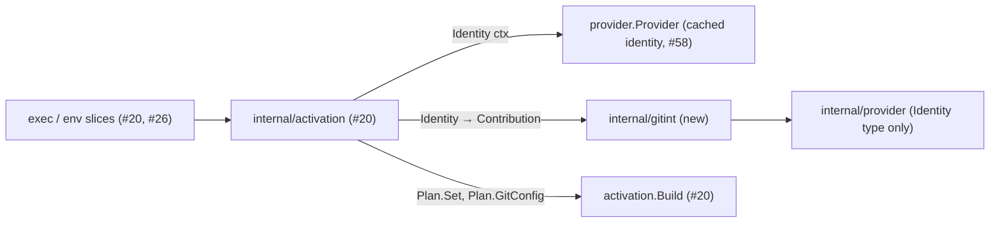

# git commit in agent mode — bot author and committer, personal signing off

Issue: #21 (E02-S07). Builds on #20 (the child environment of `exec`), the Git precedence analysis (#13, PR #30) with decisions O1–O4 (PR #49), and #58 (the cached bot identity of a GitHub profile). Extended by #22 (Git transport), which adds its entries to the same module.

Extends: `.ai/specs/2026-11-13-exec-child-environment.md` (it fills the plan fields `Set` and `GitConfig` that #20 left empty for #21)

## 📝 TLDR

Inside `agent-id exec` (and `agent-id env`), an ordinary `git commit` still uses the developer's name, email, and signing key: #20 marks the process tree as agent mode but adds no Git identity. This spec proposes `internal/gitint`, whose first pure function turns the profile's bot identity into the four author and committer variables and three process-scoped Git configuration entries: `commit.gpgSign=false`, `tag.gpgSign=false`, `tag.forceSignAnnotated=false`. `internal/activation` puts them into the plan, appended after any inherited `GIT_CONFIG_*` entries. The identity comes from the profile's cache with no network call, and a missing or malformed identity stops `exec` before the command starts, so an agent never commits as the developer by accident. Nothing is written anywhere, so the developer's own commits are unchanged.

## 📝 Problem Statement

- Brief §8 (*Git author and committer*, P0): new commits made through normal Git commands in agent mode use the configured bot name and email. Brief §9.3: disable inherited personal commit signing in agent mode unless an explicit agent signing configuration exists, and never claim that App pushes produce verified commits.
- The analysis (§4 rows I1–I6, S1–S8, G1) shows that the author and committer variables override `user.*`, `author.*`, `committer.*`, and `git -c user.email`, and that `commit.gpgSign`/`tag.gpgSign`/`tag.forceSignAnnotated=false` in `GIT_CONFIG_COUNT` beat global and repository signing. It also shows that a personal signer runs on every commit without them (S1). With signing left on, the agent signs commits with the developer's key: the bot's commit would carry the human's verified signature.
- The exec spec reserves `Plan.Set` and `Plan.GitConfig` for #21 and owns the append rule; this story supplies the data and the module that later #22 extends.

## 📝 Proposed Solution

1. **`internal/gitint` (new module, root package).** One pure function, `Identity(id provider.Identity) (Contribution, error)`:
   - checks the identity (below) and fails with `ErrIdentityInvalid` without echoing a malformed value;
   - returns `Set`: `GIT_AUTHOR_NAME`, `GIT_COMMITTER_NAME` = name; `GIT_AUTHOR_EMAIL`, `GIT_COMMITTER_EMAIL` = email;
   - returns `GitConfig`, in this order: `commit.gpgSign` = `false`, `tag.gpgSign` = `false`, `tag.forceSignAnnotated` = `false`.
2. **Activation wiring (`internal/activation`, #20).** `Activate` adds one step after the readiness check: ask the profile's provider for `Identity(ctx)`, call `gitint.Identity`, and put `Set` and `GitConfig` into the plan. `Build` (#20) then appends the entries after the inherited ones and records `AGENT_ID_GIT_CONFIG_BASE`/`_END`, so nesting and re-entry work unchanged.
3. **No network.** The provider that activation receives answers `Identity` from the profile's cached identity, as the exec spec requires of the provider source; `Ready` (#20) has already refused a profile without that cache. On `main` today, `github.Provider.Identity` calls the API (`Bot`: `GET /app` with an App JWT, then `GET /users/…`) and `github.New` parses the key up front, so a change is needed. The owner is #58, whose scope is to derive the Git author from the cached identity. The mechanism: the provider source builds the GitHub provider from the decoded `ProfileSettings`; `Identity` returns `CommitIdentity(cache.Login, cache.UserID)` with no I/O; the key is loaded only when `Token` is first called. `githubtest` gets a case that records zero requests for `Identity` on such a provider. If #58 merges without this, #21's Phase 3 adds it before the process tests.
4. **No agent signing yet.** Profile config v1 has no signing setting, and agent-specific signing is an OPEN decision (#28). So in v1 the signing entries are always emitted. When #28 adds a signing configuration, `gitint` gets a second input and leaves the three `false` entries out for that profile; this spec does not design that.

### Identity check (pure)

| Field | Rule | Why |
|---|---|---|
| name | 1–255 bytes, valid UTF-8, no rune for which `unicode.IsControl` holds (C0, `U+007F`, C1), no `U+2028`/`U+2029`, no `<` or `>`, no leading or trailing space | Git strips or refuses these in an ident line; a newline would inject a header into the commit object. |
| email | 3–254 bytes, printable ASCII, exactly one `@` with a non-empty local part and domain, no space, `<`, `>`, `,`, or `"` | Same; keeps the `<email>` part of the ident line well-formed. |

The GitHub values (`claude-dev[bot]`, `12345678+claude-dev[bot]@users.noreply.github.com`) pass; #58 already restricts the login and id, so this is defense in depth against a future provider or a bug, as is #20's secret guard in `Build`.

### Why these entries

| Entry | Rows | Reason |
|---|---|---|
| the four `GIT_AUTHOR_*`/`GIT_COMMITTER_*` variables | I1–I3, I6 | They beat every configuration source and `git -c user.*`, and satisfy `user.useConfigOnly`. |
| `commit.gpgSign=false` | S2, S4 | Turns off global and repository commit signing; also covers `merge`, `rebase`, `cherry-pick`, `am`, and `commit --amend`, which read the same key. |
| `tag.gpgSign=false` | S6 | Turns off tag signing. |
| `tag.forceSignAnnotated=false` | S8; Git `builtin/tag.c` | `tag.forceSignAnnotated=true` signs a tag that gets a message without `-a` (`git tag -m msg v`), even when `tag.gpgSign=false`. `git tag -a` never reads it, which is why the analysis row S7 (only `-a`) passed without it. |

Left out on purpose: `user.name`/`user.email` entries (OQ1); `push.gpgSign` (GitHub does not accept signed pushes, so a personal `push.gpgSign=true` makes the push fail instead of signing anything with the developer's key, and `if-asked` never signs against GitHub); `gpg.program`, `gpg.format`, `user.signingKey` (unused once signing is off; an agent's explicit `git commit -S`, `git tag -s` or `git tag -u` is a documented bypass, S3); `author.*`/`committer.*` (the variables beat them, I2).

### Alternatives considered

| Option | For | Against | Verdict |
|---|---|---|---|
| **Variables + signing `GIT_CONFIG_COUNT` entries, appended (#20's rule)** | Process-scoped; the analysis proved each row; preserves inherited entries (G1); re-entry already handled by #20; only entries the brief and `ARCHITECTURE.md` already name. | `git config user.email` still reports the developer (OQ1). | **Chosen** |
| Variables plus `user.*` entries | `git config user.email` inside the agent would report the bot, matching the commits. | Adds two entries to the emitted environment that the brief and `ARCHITECTURE.md` do not name (an "Ask first" contract change); no commit depends on them. | Not in v1 (OQ1, owner) |
| `user.*` entries only, no variables | One source. | A repository's `author.*`/`committer.*` would beat them (I2), and `git -c user.email` would too (I3). | Rejected |
| Write `user.*` into the repository's `.git/config` | Visible to every tool, including libgit2-based ones that ignore `GIT_CONFIG_COUNT`. | Writes a file that the developer's own terminal also reads: the developer would commit as the bot (`ARCHITECTURE.md`: never write `.git/config`). | Rejected |
| Resolve the identity over the network at start | Always fresh. | `exec` starts offline by decision (exec spec, OQ1/OQ2); `setup` and `doctor` refresh the cache. | Rejected |
| Keep the developer's signing when the developer opts in | Signed bot commits. | It would be the developer's key on the bot's commits: the impersonation the product exists to stop (brief §15). Agent signing is #28. | Rejected |

## 📝 Delta

### Capability: git-identity

#### ADDED Requirement: Bot author and committer in agent mode
The system SHALL make every commit created by an ordinary `git commit` inside an agent context carry the profile's bot name and email as author and committer, whatever the global, repository, `includeIf`, or `git -c user.*` configuration says.

##### Scenario: Personal identity configured
- WHEN the isolated global config sets `user.name=Dev`, `user.email=dev@example.com`, `author.email=a@example.com`, and the test runs `agent-id exec --profile claude -- git commit --allow-empty -m x` in a fresh repository
- THEN `git log -1 --format='%an <%ae>|%cn <%ce>'` prints `claude-dev[bot] <12345678+claude-dev[bot]@users.noreply.github.com>|claude-dev[bot] <12345678+claude-dev[bot]@users.noreply.github.com>`

##### Scenario: Inherited identity variables
- WHEN the parent environment has `GIT_AUTHOR_NAME=Dev` and `GIT_COMMITTER_EMAIL=dev@example.com`
- THEN the commit made inside the context still has the bot as author and committer

#### ADDED Requirement: Personal signing off in agent mode
The system SHALL turn off commit signing, tag signing, and forced signing of tags with a message inside an agent context, so that no inherited signing configuration runs a signer.

##### Scenario: Global SSH signing
- WHEN the global config sets `commit.gpgSign=true`, `tag.gpgSign=true`, `tag.forceSignAnnotated=true`, `gpg.format=ssh`, `user.signingKey`, and `gpg.ssh.program` points to a fake signer that logs every call, and the agent runs `git commit --allow-empty -m x`, `git tag -a v1 -m v1`, and `git tag -m v2 v2` (no `-a`)
- THEN the fake signer's log is empty, `git cat-file commit HEAD` has no `gpgsig` header, and neither `git cat-file tag v1` nor `git cat-file tag v2` has a signature block

##### Scenario: forceSignAnnotated is load-bearing
- WHEN the same fixture runs `git tag -m v3 v3` in an environment built from a plan without the `tag.forceSignAnnotated=false` entry (a test-only plan)
- THEN the fake signer is called, proving that the entry, not `tag.gpgSign=false`, stops it

##### Scenario: Repository-level signing
- WHEN only the repository config sets `commit.gpgSign=true`
- THEN the commit made inside the context is unsigned and the signer is not called

#### ADDED Requirement: Inherited process configuration preserved
The system SHALL keep every well-formed inherited `GIT_CONFIG_COUNT` entry effective inside the context, except where one of its own keys is set later by agent-id, which then wins as the last value.

##### Scenario: Unrelated inherited entry
- WHEN the parent has `GIT_CONFIG_COUNT=1`, `GIT_CONFIG_KEY_0=core.abbrev`, `GIT_CONFIG_VALUE_0=12`
- THEN `git config core.abbrev` inside the context prints `12`

##### Scenario: Inherited signing entry is overridden
- WHEN the parent has `GIT_CONFIG_COUNT=1`, `GIT_CONFIG_KEY_0=commit.gpgSign`, `GIT_CONFIG_VALUE_0=true`
- THEN the last value of `git config --get-all commit.gpgSign` inside the context is `false` and the inherited `true` is still listed before it, `git config commit.gpgSign` prints `false`, and the commit is unsigned

#### ADDED Requirement: Developer terminal unchanged
The system SHALL NOT change the identity or signing of commits made outside the agent context.

##### Scenario: Commit after the agent
- WHEN, after the agent's commit, the test commits in the same repository with the parent environment
- THEN author and committer equal what `git var GIT_AUTHOR_IDENT` and `git var GIT_COMMITTER_IDENT` report in the parent environment (name and email only), neither is the bot, the fake signer was called once, and the global and repository config files hash the same as before the agent ran

#### ADDED Requirement: No start without a valid identity
The system SHALL refuse to start the command, with exit status 125, when the provider cannot supply the bot identity from the profile or the identity fails the check, and SHALL NOT contact the provider to obtain it.

##### Scenario: Malformed cached identity
- WHEN the provider returns the name `claude\nmallory` (a test fake)
- THEN `exec` exits 125 with `ErrIdentityInvalid`, the message does not contain the name, and the command does not run

##### Scenario: No network for the identity
- WHEN `exec` starts a command for a profile with a cached identity while the fake GitHub records requests
- THEN the fake GitHub received no request

## 📝 Architecture

Activation asks the provider for the identity and `gitint` for the Git data; `Build` alone composes the environment.

- **`internal/gitint`** (new module root; `ARCHITECTURE.md` lists it as planned). Exported: `Contribution{Set map[string]string; GitConfig []Entry}`, `Entry{Key, Value string}`, `Identity(provider.Identity) (Contribution, error)`, `ErrIdentityInvalid`. It imports `internal/provider` for the `Identity` type and nothing else from the repository; it does not import `internal/activation` (activation imports it, `ARCHITECTURE.md` components table). #22 adds the transport entries to this package (a second function, or an extra input to a combined one); the order is fixed: the identity group, then the transport group. `Contribution` has no `Unshadow` field: the env spec's `git` unshadow contribution is added by #26 when it introduces `Plan.Unshadow`. The existing depguard rule `github-only-in-its-adapter` already keeps the adapter out of `gitint`; no new rule is needed.
- **`internal/activation`** (#20): `Activate` calls `p.Identity(ctx)` after `Ready` and before the inherited-Git check, maps `Contribution` into `Plan.Set` and `Plan.GitConfig` (`Entry` → `GitConfigEntry`), and wraps a failure in a new sentinel `ErrIdentityUnavailable` (exit 125). The hint in the message comes from the provider, as for `ErrProfileNotReady` (exec spec); `gitint` and `activation` name no forge and no setup subcommand. Nothing else in #20's contract changes: the context version stays `1`, because no release has `exec` without #21 (exec spec, Risks).
- **Provider source** (#20, with #58): the provider handed to activation answers `Identity` from the profile's cache without reading the key or calling the network. This is already the exec spec's rule; #21 adds the process test that proves it (no request on the fake GitHub).
- **`env`** (#26) prints the same plan, so the variables and entries appear in the rendered script with no change there. The `Unshadow` contribution `git` (env spec) belongs to #26.
- **`doctor`** (#24) check D6 compares the context against these entries; that check is #24's.
- No new Go module dependency; no change to the profile config.

## 📝 API Contracts

### Child environment additions (contract version 1)

| Kind | Name | Value |
|---|---|---|
| variable | `GIT_AUTHOR_NAME`, `GIT_COMMITTER_NAME` | the provider's identity name (`claude-dev[bot]`) |
| variable | `GIT_AUTHOR_EMAIL`, `GIT_COMMITTER_EMAIL` | the provider's identity email (`12345678+claude-dev[bot]@users.noreply.github.com`) |
| `GIT_CONFIG_*` entry `base+0` | `commit.gpgSign` | `false` |
| `base+1` | `tag.gpgSign` | `false` |
| `base+2` | `tag.forceSignAnnotated` | `false` |

`base` is the inherited count (`AGENT_ID_GIT_CONFIG_BASE`). #22 appends after `base+2`. Keys use Git's canonical camel case; Git compares them case-insensitively.

### Errors (exit 125, after `agent-id: exec: `)

| Sentinel | Message |
|---|---|
| `activation.ErrIdentityUnavailable` | `profile "claude": cannot read the bot identity: <provider error>; <provider hint>` (the GitHub hint is `run agent-id setup github --profile claude`, supplied by the adapter) |
| `gitint.ErrIdentityInvalid` (wrapped by the above) | `profile "claude": the cached bot identity is malformed (<name\|email>: <rule>); <provider hint>`. The value itself is never printed, and `gitint`'s own text names no provider. |

## 📝 Edge Cases & Failure Scenarios

| Situation | Behavior |
|---|---|
| Agent runs `git commit --author="Dev <dev@example.com>"` | Author is the developer, committer is the bot (I4). Documented bypass: commit metadata is attribution, not proof (brief §9.3). |
| Agent runs `git commit -S`, `git tag -s`, or `git tag -u <key>` | The developer's signer runs (S3). Documented bypass; `doctor` cannot see it. |
| Personal `push.gpgSign=true` | Every agent push fails with "the receiving end does not support --signed push"; nothing is signed. Documented; `doctor` (#24) reports the key. Adding `push.gpgSign=false` is a contract change left to #22 with the owner. |
| Agent or script runs `git config user.email` | Prints the developer's email: commits use the variables, not `user.*` (OQ1). `whoami` shows the bot. |
| Agent runs `git -c commit.gpgSign=true commit` | `-c` beats `GIT_CONFIG_COUNT` (P2): signed. Same bypass class as `-S`. |
| Inherited `GIT_CONFIG_PARAMETERS` with `commit.gpgSign`/`user.signingKey` | `exec` refuses to start (O2, #20). |
| Inherited `GIT_CONFIG_PARAMETERS` with `user.email` | Kept (not an O2 key); the variables still decide the commit (I3); `git config user.email` reports the `PARAMETERS` value. `doctor` D4 reports the variable. |
| `user.useConfigOnly=true` and no personal `user.email` | Works (I6). |
| `commit --amend`, `rebase`, `cherry-pick` of a developer's commit | The original author is kept (Git's normal behavior); the committer becomes the bot; the result is unsigned. |
| Repository's branch protection requires signed commits | Pushes of bot commits to that branch are rejected by GitHub. Expected until agent signing (#28); the push error comes from GitHub, and the docs say so. |
| A libgit2- or JGit-based tool inside the agent | May ignore `GIT_CONFIG_COUNT` and the variables and use the developer's identity. Outside the supported paths (brief §10; Git CLI only). |
| Startup file of the agent's shell unsets the variables or `GIT_CONFIG_COUNT` | Personal identity again (R8). Documented bypass; the next nested `exec` refuses (#20), `doctor` D6 reports it. |
| Nested `exec` with the same profile after `setup` refreshed the identity | Re-entry rebuilds the entries with the new identity (#20's rule). |
| Provider identity name of 300 bytes or with `<` | `ErrIdentityInvalid`; exit 125; command not run. |
| Git older than 2.31 (no `GIT_CONFIG_COUNT`) | Below the supported minimum 2.43 (O4); `doctor` reports the version. |

## 📝 Risks & Impact Review

- **Contract.** Four variable names and three entries join the child environment contract v1 (`AGENTS.md`, Ask first: the environment `exec` and `env` emit). All of them were already named by brief §9.3, `ARCHITECTURE.md` (Git integration) and the analysis set (rows 12–14); this spec adds nothing beyond them, and the `user.*` entries wait for the owner (OQ1). After the first release, a change needs `AGENT_ID_CONTEXT=2`.
- **Unsigned bot commits are a visible change** for teams whose repositories require signed commits; brief §9.3 decided this, and agent signing is #28. No text may claim that the bot's commits are verified.
- **Attribution, not proof** (brief §9.3, §10). An agent can set `--author`, sign with `-S`, or drop the variables; local mode does not prevent it, and the docs list these bypasses (analysis §7).
- **Fail closed.** A missing or malformed identity stops `exec` with 125 rather than starting a command that would commit as the developer.
- **Dependencies.** #21 needs #20 (activation and `exec`) and #58 (cached identity in the GitHub provider). Its pure step (Phase 1) needs neither.

## 📝 Decisions in play

- Brief §8 (*Git author and committer*), §9.3 (signing, attribution), §10 (not a boundary), §15.
- `ARCHITECTURE.md`: Git integration, Key decisions (process-scoped Git configuration; turn off inherited personal signing; agent signing OPEN).
- Git precedence analysis §5 rows 12–14 and decisions O1–O4 (PR #49).
- Exec spec: the plan, the append rule, re-entry, exit code 125, OQ1/OQ2 (no network at start).

## Open Questions (owner) — recommendation applied

| # | Question | Recommendation (applied) | Why | Confirm? |
|---|---|---|---|---|
| OQ1 | Should the child environment also carry `user.name`/`user.email` entries, so that `git config user.email` inside the agent reports the bot? | **No in v1.** Only the variables and the signing entries. | Adding entries to the emitted environment is an "Ask first" contract change; commits are correct without them; adding them later is additive within contract v1 before the first release. | owner, non-blocking (environment contract) |

## Resolved assumptions (autonomous defaults)

Agent signing stays out of scope (#28). Technical decisions taken by this spec:

| # | Question | Applied default | Why | Confirm? |
|---|---|---|---|---|
| A1 | Where does the Git identity logic live? | `internal/gitint`, one pure function; `activation` wires it. | `ARCHITECTURE.md` (Git integration module; dependency rule 5). | reversible |
| A2 | Order of the entries | `commit.gpgSign`, `tag.gpgSign`, `tag.forceSignAnnotated`, before #22's transport group. | Deterministic golden tests; keys do not overlap with #22's. | reversible |
| A3 | Signing entries | `commit.gpgSign`, `tag.gpgSign`, `tag.forceSignAnnotated` = `false`, always in v1. | Analysis §5 rows 12–14; v1 has no agent signing config (#28 OPEN). | reversible |
| A4 | `push.gpgSign`? | Not set. | Signed pushes fail against GitHub instead of signing; no personal signature can leak. | reversible |
| A5 | Where does the identity come from at start? | `provider.Identity` answered from the profile's cache; no network. | Exec spec OQ1/OQ2; `Ready` already requires the cache. | reversible |
| A6 | Identity check | The rules of the Identity check table; failure is exit 125 without echoing the value. | Defense in depth against header injection into the commit object. | reversible |
| A7 | Context version | Stays `1`. | No release has `exec` without #21. | reversible before the first release |

## 📋 Phasing

One implementation PR (`Closes #21`), `risk-high`, after #20 and #58 merge.

- **Phase 1 — `internal/gitint`.** The pure function, its checks, and its tests. Needs nothing.
- **Phase 2 — activation wiring.** Needs #20's `Activate` and `Plan`.
- **Phase 3 — process tests and record.** Needs #20's `exec` command and #58's cached identity in the production provider.

## 📋 Implementation Plan

Every test calls `testenv.Isolate(t)` first. Process tests use real `git` (≥ 2.43) in the isolated environment, a fake signer script under the test root, `testenv.BuildBinary`, and `testenv.Main` in `TestMain`. No real key, token, or network.

### Phase 1 — `internal/gitint`

1. **Contract.** Package `internal/gitint` with its `AGENTS.md` (invariants: pure functions, names no forge, writes no file, never echoes an identity value in an error, `GIT_CONFIG_*` only through activation's append), the types and `ErrIdentityInvalid`, and a row in the root `AGENTS.md` task routing. The existing depguard rule already covers it.
2. **`Identity`.** Table tests: the GitHub example (exact `Set` and `GitConfig`, in order); names with a newline, `\r`, NUL, `U+007F`, `U+0085`, `U+2028`, `<`, `>`, leading or trailing space, empty, 256 bytes, invalid UTF-8; emails without `@`, with two `@`, with a space, `<`, `,`, `"`, empty local part or domain, 255 bytes, non-ASCII; every failing error is checked not to contain the value. Golden test of the entry list. A test that `Identity` returns new slices and maps on every call (no shared state).

### Phase 2 — activation

3. **Wiring.** `Activate` calls `Identity` after `Ready`; `ErrIdentityUnavailable`; plan mapping. `providertest.Fake` gains `SetIdentity` and `FailIdentity` (the malformed-identity and failure scenarios are handler-level tests with them; the process tests use the real adapter). Handler tests with `providertest.Fake`: identity present → plan contains the four variables and three entries after an inherited count of 2; provider `Identity` error → 125 and the command not executed (recording `Execer` empty); malformed identity → 125 without the value in the message; order of checks (nesting, readiness, identity, inherited Git, preflight). `Build` property tests of #20 rerun with the new plan data (idempotent re-entry, append-only).

### Phase 3 — process tests and record

4. **Process tests** (one test package, real `git`): every Delta scenario. The expected bot name and email come from the fixture the test writes (for example `githubtest`'s `aidtest-agent[bot]`), not from the spec's `claude-dev` example. The fake SSH signer writes `<file>.sig` as `ssh-keygen -Y sign` does, and logs its call. Hostile global config: `user.*`, `author.*`, `committer.*`, `user.useConfigOnly`, SSH signing with a logging fake `gpg.ssh.program`, OpenPGP `tag.gpgSign` with a logging fake `gpg.program`, `tag.forceSignAnnotated`; an `includeIf "gitdir:"` file with its own `user.email`; a repository `commit.gpgSign=true`; inherited `GIT_CONFIG_COUNT` entries (`core.abbrev`, `commit.gpgSign=true`); inherited `GIT_AUTHOR_NAME`. Checks: `git log` identities, no `gpgsig` header, no tag signature, empty signer logs inside the context, the developer's commit afterwards (personal identity, one signer call), hashes of the global and repository config unchanged, zero requests on the fake GitHub, and no `ghs_`, `-----BEGIN`, or JWT shape in agent-id's own stdout and stderr (Git's output of a signed object in the developer's run is not scanned).
5. **Record.** `ARCHITECTURE.md`: components (gitint exists), Git integration (the identity variables and signing entries; and that `activation` asks the provider for the identity and passes the value to `gitint`, rather than `gitint` asking the provider as the components table and the profile-config spec describe), Key decisions row (A1–A7, this spec). Docs: the known bypasses (`--author`, `-S`, `git -c`, shell startup files) and the signed-commits branch-protection limit. Archive the Delta into `.ai/specs/capabilities/git-identity.md`.
