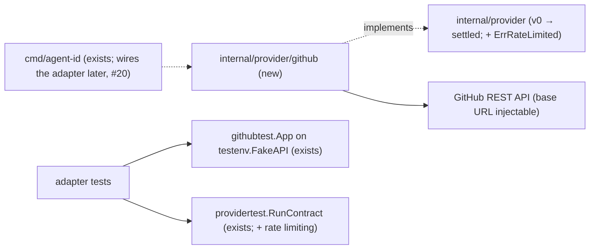

# GitHub provider adapter: App JWT, installation tokens, bot identity

Extends: `.ai/specs/2026-11-12-profile-config.md` (its Phase 2, the `github` profile block, stays as written there and follows #17; see Phasing)

Issue: #15 (E02-S01). Builds on ADR #35 (`ARCHITECTURE.md`, Provider abstraction), the v0 interface in `internal/provider` (PR #32), and the fake GitHub App in `internal/provider/github/githubtest`.

## 📝 TLDR

agent-id has a provider interface (`internal/provider`, v0) and a fake GitHub App, but no code that talks to GitHub. This spec proposes the first real adapter, `internal/provider/github`. Given an App ID, an installation ID and an App private key, it signs an RS256 App JWT with the Go standard library, mints installation tokens, resolves the bot user (`<slug>[bot]`, numeric id, noreply email), and lists the installation's repositories. Every failure maps to a provider error, and no token, JWT or key ever appears in an error. The adapter passes `providertest.RunContract` against the fake GitHub App, and this spec settles the v0 interface with one addition: `provider.ErrRateLimited`.

## 📝 Problem Statement

- Brief §8 (*GitHub App profile setup*) and §9.2 (*GitHub provider*): nothing can mint the agent's tokens or say which bot commits. The token manager, the credential helper, the `gh` injection, `setup` and `doctor` all wait for this adapter (backlog E02).
- The adapter holds the most sensitive code path of the product: it holds the App private key, which can mint tokens for every installation of the App (brief §10), and it produces the bearer tokens that the agent uses. `SDLC.md` classifies it as `risk-high`.
- ADR #35 says the first adapter shapes the interface. The v0 interface has no way to report rate limiting, and the issue asks for it as a typed error.

## 📝 Proposed Solution

A new package `internal/provider/github`, written from scratch with the standard library only (owner decisions on #15: no GHAPP code, no `go-githubauth`). It needs no new module dependency.

1. **Construction.** `New(Config) (*Provider, error)` takes the App ID, the installation ID, the PEM private key bytes (already loaded by the credential source, #16), and optional test hooks: the API base URL, the HTTP client, and the clock. `New` parses and checks the key once and keeps only the parsed key. It never reads a file, an environment variable, or a profile.
2. **App JWT** (`signJWT`, a pure function). Header `{"alg":"RS256","typ":"JWT"}`. Claims: `iat` = now − 60 s (clock skew), `exp` = now + 9 min (under GitHub's ten-minute limit, with margin), `iss` = the App ID as a JSON number. A fresh JWT for every App request; JWTs are never cached or returned.
3. **Installation token.** `Token(ctx)` sends `POST {base}/app/installations/{id}/access_tokens` with the JWT and an empty body (the token gets the installation's full repositories and permissions; see A2). It parses `token` and `expires_at` from the 201 answer and returns `provider.Token`. It does not reject an expired `expires_at`: the token manager decides what to do with it (contract: "reports the token lifetime").
4. **Bot identity.** `Bot(ctx)` sends `GET {base}/app` with the JWT to read the App slug, then `GET {base}/users/{slug}%5Bbot%5D` without credentials (A4) to read the numeric id. It checks that the answer is the requested bot. `Identity(ctx)` returns `CommitIdentity(login, id)`, a pure function: name `<slug>[bot]`, email `<id>+<slug>[bot]@users.noreply.github.com`.
5. **Repositories.** `Repositories(ctx, token)` reads `GET {base}/installation/repositories?per_page=100&page=N` with the installation token until the page is short or `total_count` is reached, with a cap of 100 pages. This method belongs to the adapter only, not to the interface (A6).
6. **Git and CLI.** `GitCredential` returns `https`, `github.com`, `x-access-token`, and the token. `CLIEnvironment` returns `GH_TOKEN=<token>` and `GH_HOST=github.com` (the host pin of `.ai/analysis/2026-11-12-gh-installation-token-matrix.md`). Dropping inherited variables stays with `internal/cliint` (#23).
7. **Failure mapping** (`classify`, a pure function of status and headers). 401 → `ErrUnauthorized`. 404 → `ErrNotFound`. 429, or 403 with `X-RateLimit-Remaining: 0` or `Retry-After` → `ErrRateLimited`. Any other 403 → `ErrForbidden`. 5xx, any other status, a transport error, or an unusable answer → `ErrUnavailable`. A canceled or expired context returns the context's error. The message names the operation and the HTTP status, never the response body, the URL query, a header, a JWT, a token, or the key.
8. **Hardening.**
   - Redirects are not followed (`CheckRedirect` → `http.ErrUseLastResponse`), so a credential never leaves the base URL.
   - A response body is read up to 1 MiB.
   - A token value must be 1–4096 visible ASCII characters (`0x21`–`0x7e`). This keeps a hostile answer from injecting a newline into the credential helper protocol or the child environment.
   - The base URL must be `https`, or `http` to a loopback IP for the fake.
   - `*Provider` implements `fmt.Formatter` and prints only the App and installation IDs.

### Alternatives considered

| Option | For | Against | Verdict |
|---|---|---|---|
| A third-party GitHub client (`go-github`) or JWT library | Less code | Owner decision (#15): standard library, no `go-githubauth`. A new dependency is an "Ask first" item. Most of the client would go unused. | Rejected |
| `iss` = the App's Client ID | GitHub's current recommendation | The profile stores `app_id` (profile-config spec), not the Client ID, and GitHub still accepts the App ID. Changing it later is local to `signJWT`. | Deferred (A1) |
| Cache the JWT for its lifetime | Fewer signatures | More state that holds a credential. An RSA signature costs about 1 ms, and the token manager (E02-S04) already caches tokens. | Rejected |
| `ErrRateLimited` as a new, independent sentinel | Precise | Core code that handles only `ErrUnavailable` would miss it. Wrapping `ErrUnavailable` keeps it fail-closed for old callers. | Wrapped (A5) |
| Follow `Link: rel="next"` for repositories | GitHub's pagination contract | A hostile or misconfigured answer could point the token at another host. Counting pages on the fixed base URL gives the same result. | Rejected |

## 📝 Delta

### Capability: github-provider

#### ADDED Requirement: Installation token minting
The GitHub adapter SHALL mint an installation token with an RS256 App JWT and report the token's value and expiry as GitHub returned them.

##### Scenario: Token from the fake GitHub
- WHEN the fake GitHub App has installation 7 and the adapter is built for that App and installation
- THEN `Token` sends `POST /app/installations/7/access_tokens` with an `Authorization: Bearer` JWT that `githubtest` accepts (RS256, `iss` the App ID, `exp` − `iat` ≤ 10 min), and returns the fake token with the reported `expires_at`

#### ADDED Requirement: Failures map to provider errors without secrets
The GitHub adapter SHALL report every failure as one of the provider errors and SHALL NOT include a JWT, a token, or key material in the error.

##### Scenario: Denied token request
- WHEN the fake answers 401, 403, 404, 429, or 503 to a token request
- THEN `Token` returns the zero `Token` and an error that matches `ErrUnauthorized`, `ErrForbidden`, `ErrNotFound`, `ErrRateLimited`, or `ErrUnavailable` respectively, and the error text contains neither the JWT nor any token

##### Scenario: Primary rate limit on a 403
- WHEN GitHub answers 403 with `X-RateLimit-Remaining: 0`
- THEN the error matches `ErrRateLimited` and `ErrUnavailable`, and not `ErrForbidden`

#### ADDED Requirement: Bot commit identity
The GitHub adapter SHALL derive the commit name `<slug>[bot]` and email `<id>+<slug>[bot]@users.noreply.github.com` from the App's bot user.

##### Scenario: Known slug and id
- WHEN the slug is `claude-dev` and the bot user id is 12345678
- THEN the name is `claude-dev[bot]` and the email is `12345678+claude-dev[bot]@users.noreply.github.com`

##### Scenario: Answer for another account
- WHEN `GET /users/{slug}[bot]` answers with a different login or a type other than `Bot`
- THEN `Bot` and `Identity` fail with `ErrUnavailable` and return no identity

#### ADDED Requirement: Installation repositories
The GitHub adapter SHALL list the repositories that an installation token can access, as `owner/name`.

##### Scenario: Installation with two repositories
- WHEN the fake installation holds `o/a` and `o/b`
- THEN `Repositories` returns `o/a` and `o/b`

#### ADDED Requirement: Credentials stay on the API host
The GitHub adapter SHALL NOT follow redirects and SHALL NOT accept a token value with characters outside visible ASCII.

##### Scenario: Redirect to another host
- WHEN the API answers a token request with 307 to another listener
- THEN the adapter fails with `ErrUnavailable`, and the other listener receives no request

##### Scenario: Token with a newline
- WHEN the token answer holds `"ghs_aidtest_x\nusername=evil"`
- THEN `Token` fails with `ErrUnavailable` and returns the zero `Token`

## 📝 Architecture



The takeaway: the adapter depends only on `internal/provider` and the standard library. Nothing in core changes, and only its tests know the fake.

```go
type Config struct {
    AppID          int64
    InstallationID int64
    PrivateKeyPEM  []byte           // PKCS#1 or PKCS#8 RSA, ≥ 2048 bits; not kept after New
    BaseURL        string           // "" → https://api.github.com
    HTTPClient     *http.Client     // nil → 30 s timeout, no redirects
    Now            func() time.Time // nil → time.Now
}
func New(cfg Config) (*Provider, error)                   // ErrInvalidConfig, ErrInvalidKey (local sentinels)
func (p *Provider) Name() string                          // "github"
func (p *Provider) Host() string                          // "github.com"
func (p *Provider) Token(ctx context.Context) (provider.Token, error)
func (p *Provider) Identity(ctx context.Context) (provider.Identity, error)
func (p *Provider) Bot(ctx context.Context) (BotUser, error)            // BotUser{Login string; UserID int64}
func (p *Provider) Repositories(ctx context.Context, token provider.Token) ([]Repository, error) // Repository{Owner, Name string}
func (p *Provider) GitCredential(token provider.Token) provider.GitCredential
func (p *Provider) CLIEnvironment(token provider.Token) []string
func CommitIdentity(login string, userID int64) (provider.Identity, error)
func TokenPrefixes() []string                              // ghs_, ghp_, gho_, ghu_, ghr_, github_pat_ (for #17's secret scan)
```

- **Interface (`internal/provider`).** Add `ErrRateLimited`, which wraps `ErrUnavailable`. `providertest.RunContract` adds it to the failures every provider must report, and `providertest.Fake` and `githubtest` (429) support it. Nothing else changes. The ADR's remaining responsibilities stay with their tickets: the variables to drop (#23) and the SSH→HTTPS rewrites (#22). After this spec, the interface is the agreed shape for those tickets rather than v0.
- **`githubtest`** exports `FailTokensWith(err)`, so that the adapter's contract test can drive the fake from another package, and maps 429 to `ErrRateLimited`.
- **Profile block** (`profile-config` Phase 2: `ProfileSettings`, strict decode, identity cache). It needs `internal/profile`, which #17 is building in parallel. It is not part of this implementation (A7). `CommitIdentity` and `TokenPrefixes` are the pieces it will reuse.
- **Wiring.** Nothing constructs the adapter in `cmd/agent-id` yet: no command needs it before `setup` (#19) and activation (#20). depguard already keeps it out of core.

## 📝 Data Model

No persistent data. In memory, `Provider` holds the parsed `*rsa.PrivateKey`, the two IDs, the base URL, and the client. It is never serialized, and its `Format` prints only the IDs. No fixture contains a key: tests use the key that `githubtest.NewApp` generates per test.

## 📝 Edge Cases & Failure Scenarios

| Situation | Behavior |
|---|---|
| Key is not PEM, has trailing data, is encrypted, is EC or Ed25519, or is RSA < 2048 bits | `New` fails with `ErrInvalidKey`; the message names the problem, never the bytes. |
| `AppID` or `InstallationID` ≤ 0 | `ErrInvalidConfig`. |
| Base URL `http://example.com`, with userinfo, a query, or a fragment | `ErrInvalidConfig`. |
| Local clock ahead or behind by < 60 s | Accepted by GitHub thanks to the `iat` backdating. A larger skew gives 401 → `ErrUnauthorized`; `doctor` (#24) can report the clock. |
| App uninstalled or wrong installation ID | 404 → `ErrNotFound`. |
| App suspended | 403 → `ErrForbidden`. |
| Rate limited (429, or 403 with `X-RateLimit-Remaining: 0` or `Retry-After`) | `ErrRateLimited` (also `ErrUnavailable`). No retry in the adapter; the caller decides. |
| 201 with a missing or empty `token`, an invalid `expires_at`, a token with control characters, or a body > 1 MiB | `ErrUnavailable`; zero `Token`. |
| 3xx | `ErrUnavailable`; the redirect is not followed. |
| `/users` answers another login, a non-`Bot` type, or id ≤ 0; `/app` answers a slug that is not `[a-z0-9][a-z0-9-]{0,62}` | `ErrUnavailable`; no identity. |
| More than 100 pages of repositories | `ErrUnavailable` (cap); not expected for an agent installation. |
| Canceled context | The context's error, wrapped. |

## 📝 Risks & Impact Review

- **Key blast radius (brief §10).** The adapter holds the parsed key in process memory for its lifetime and sends it nowhere; only signatures leave. Rotation and revocation documentation belongs to `setup` (#19).
- **Contract change.** `ErrRateLimited` is additive, and it wraps `ErrUnavailable`, so a core caller written against v0 still fails closed. Every provider must now report it: today only `providertest.Fake` and `githubtest` exist.
- **Not a security boundary.** The checks stop accidents and hostile answers. A local agent can still read the key file (brief §10, `ARCHITECTURE.md`, Security model). Nothing here claims otherwise.
- **Real GitHub differences.** The fake follows GitHub's documented behavior. The first real check happens on the owner's machine with a test App, outside CI (no secrets in CI).

## 📝 Decisions in play

- Brief §8, §9.2, §10 (key blast radius, fail closed); ADR #35 and dependency rule 7; owner decisions on #15 (rewrite from scratch, standard library JWT).

## Resolved assumptions (autonomous defaults)

These are security-model details beyond the brief and the ADR. Each is applied as the most reversible choice and listed here for the owner to override.

| # | Question | Applied default | Why | Confirm? |
|---|---|---|---|---|
| A1 | JWT `iss`: App ID or Client ID? | App ID, as a JSON number. | The profile stores `app_id`, and GitHub accepts it. A switch later is local to `signJWT`. | reversible |
| A2 | Downscope the installation token (`repositories`/`permissions` in the mint request)? | No: the token gets the installation's own scope. | Brief §10: the App's permissions and the installation's repository access are the authoritative controls. Per-profile downscoping needs a new config field (a schema change). | reversible; owner may want it in a later phase |
| A3 | Minimum key strength | RSA only, ≥ 2048 bits, `Validate()` passes. | GitHub issues 2048-bit RSA keys; anything else is not a GitHub App key. | reversible |
| A4 | Credential for `GET /users/{slug}[bot]` | None (unauthenticated). | The endpoint is public. Sending no credential means none can leak there. Identity is resolved rarely (`setup`, `doctor`) and then cached in the profile. | reversible |
| A5 | Rate limiting in the interface | `provider.ErrRateLimited` wraps `ErrUnavailable`; no retry in the adapter. | The issue asks for a typed error. Wrapping keeps v0 callers fail-closed; retry policy belongs to the token manager. | reversible |
| A6 | Is repository listing part of `provider.Provider`? | No: an adapter-only method for now. | Its consumers (`setup` #19, `doctor` #24) shape the core-facing contract; adding it later is additive. | reversible |
| A7 | Does #15 also deliver the `github` profile block (profile-config Phase 2)? | Not in this PR. A follow-up issue tracks it and starts when #17 merges. | It needs `internal/profile`, which another agent is building in parallel and this task must not touch. The issue's acceptance criteria do not include it. | reversible |

## 📋 Phasing

One implementation PR (`Closes #15`), `risk-high`. Each phase leaves the gate green.

- **Phase 1 — contract.** `ErrRateLimited` in the interface, the contract, and both fakes.
- **Phase 2 — adapter.** Key, JWT, HTTP, token, identity, repositories, and the contract run against the fake App.
- **Phase 3 — docs.** Module `AGENTS.md`, `ARCHITECTURE.md`, task routing, and the archived capability.
- **Follow-up (separate issue, after #17).** The `github` profile block, as profile-config spec steps 9–11.

## 📋 Implementation Plan

Every test calls `testenv.Isolate(t)` first, talks only to `testenv.NewFakeAPI` through `testenv.NewHTTPClient(t)`, and uses only the per-test key of `githubtest.NewApp`. Run the gate in an isolated environment after each step.

### Phase 1 — interface and contract

1. **Rate limiting.** Add `provider.ErrRateLimited` (wrapping `ErrUnavailable`). Add it to `providertest`'s `failures`, to `Fake`, and to `githubtest`'s status maps (429). Export `githubtest.App.FailTokensWith`. Update `internal/provider/AGENTS.md`. Test: the existing contract runs for `Fake` and `githubtest` pass with the new failure, and `errors.Is(ErrRateLimited, ErrUnavailable)` holds.

### Phase 2 — `internal/provider/github`

2. **Key and config.** `Config`, `New`, `parsePrivateKey` (pure), `checkBaseURL` (pure), `ErrInvalidConfig`, `ErrInvalidKey`, `Format`. Hostile tables:
   - Keys: garbage, two PEM blocks, trailing bytes, an encrypted PEM header, EC and Ed25519 keys, a 1024-bit RSA key, PKCS#1 and PKCS#8 inputs.
   - Base URLs: http to a non-loopback host, userinfo, query, fragment, empty.
   - The key bytes never appear in an error or in `%v`/`%+v`/`%#v`.
3. **JWT.** `signJWT(key, appID, now)` (pure). Tests: `githubtest`'s verifier accepts it (through a token request on the fake); the header and claims are exact (`iat` = now − 60, `exp` = now + 540, numeric `iss`); a key of another App is rejected by the fake.
4. **HTTP and classification.** The request helper (headers `Accept: application/vnd.github+json`, `X-GitHub-Api-Version: 2022-11-28`, `User-Agent: agent-id`; no redirects; 1 MiB limit) and `classify(status, header)` (pure). Table: 401, 403, 403 with `X-RateLimit-Remaining: 0`, 403 with `Retry-After`, 404, 422, 429, 500, 503, 307.
5. **Token.** `Token` with response validation. Tests: the AC scenarios; the denied path for each status, with the error text checked against the JWT and the issued tokens; the hostile 201 answers of the Edge Cases table; a redirect to a second `testenv` listener that must receive nothing; a canceled context.
6. **Identity.** `Bot`, `CommitIdentity` (pure), `Identity`. Tests: `claude-dev`/12345678 (AC); the fake App's bot; a wrong login, a non-`Bot` type, id 0, and a hostile slug from `/app` (`../x`, uppercase, 64+ characters); the `/users` request carries no `Authorization`.
7. **Repositories.** Two-page pagination with a custom handler on `testenv.FakeAPI`, the fake App's installation, an expired token (401), and the page cap.
8. **Contract and Git/CLI.** `GitCredential`, `CLIEnvironment`, `TokenPrefixes`; `providertest.RunContract` against the adapter on `githubtest.NewApp`, with `FailTokensWith` and `SetTokenLifetime`.

### Phase 3 — documentation

9. **Docs and archive.** Add `internal/provider/github/AGENTS.md` (invariants: standard library only, no GHAPP code, pure security functions, no secret in errors, redirects off, the base URL rule). Add a task-routing row in `AGENTS.md`. Update `ARCHITECTURE.md`: the components tree and table (adapter exists; interface settled), and a Key decisions row for A1–A7. Archive the Delta into `.ai/specs/capabilities/github-provider.md`.
