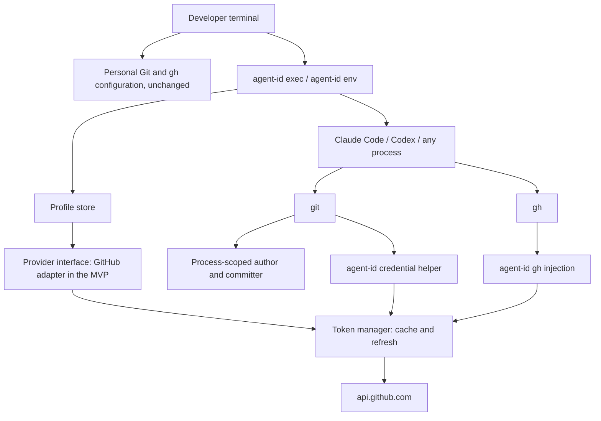

# Architecture — agent-id

The code so far is the composition root in `cmd/agent-id` (root command and `--version`), the profile store in `internal/profile` (#17), the setup slice in `internal/setup` (#19), and the test helpers in `internal/testenv`, `internal/provider/providertest`, and `internal/provider/github/githubtest`, with the provider interface in `internal/provider` and its GitHub adapter in `internal/provider/github` (#15), and the credential source in `internal/credential` (#16). Every other module below is **planned**. This file records the target structure so that new code follows it. Rows marked **OPEN** are undecided: they mirror `PRODUCT_BRIEF.md` §14 and the design questions of §9.4, and code must not assume an answer. Keep this file current as the system changes; agents read it (through `AGENTS.md`) before structural changes.

## Purpose and scope

agent-id binds an agent profile to Git identity, Git transport credentials, and GitHub API credentials for one process and its descendants (brief §6). The developer's terminal keeps its personal Git and `gh` configuration; a process started through `agent-id exec` (or a shell that loaded `agent-id env`) uses a GitHub App bot identity with installation tokens that are minted, cached, and refreshed automatically.

In scope for the MVP (brief §8, Phase 1): one GitHub App profile, process-scoped activation, Git author and committer, Git transport credentials, `gh` token injection, token cache and refresh, fail-closed behavior, `whoami` and `doctor`, and a Claude Code `SessionStart` integration. GitHub.com, macOS and Linux, Bash and Zsh. Deferred (brief §8, MVP boundaries): Windows, GitHub Enterprise Server, custom Git hosts, managed team deployment, other providers. The code still reaches GitHub only through a provider interface, so that GitLab and Bitbucket can be added later as adapters (see Provider abstraction). Not a goal (brief §6): an AI agent or orchestrator, a replacement for Git or `gh`, a password manager or IAM platform, a security sandbox in local mode, a continuation of GHAPP.

## System context



The child environment is the only activation mechanism: agent-id never writes to `~/.gitconfig`, the system Git configuration, `~/.config/gh`, the ghapp configuration, shell startup files, or the repository's `.git/config`.

## Components

The layout follows orbit: a vertical slice architecture adjusted to Go. A **module** is a bounded context under `internal/`. A **slice** is one user-visible operation: one Go package that holds its contract, handler, CLI command, and tests.

```text
cmd/agent-id/              composition root: build adapters, wire slices, run            (exists)
internal/
  testenv/                 test isolation: temporary HOME/XDG/Git/gh config, network guard, fake host API, HTTPS Git server, bare repositories (exists)
  profile/                 module: profile config (non-secret metadata, key references) (exists, #17)
  credential/              module: private key sources: protected file; keyring OPEN     (exists, #16)
  provider/                code-host boundary (ADR #35): Provider interface, provider errors (exists; settled by #15)
    providertest/          provider contract (RunContract) and a provider-neutral Fake for core tests (exists)
    github/                adapter: GitHub App JWT, installation tokens, bot identity, gh  (exists, #15; profile block #58)
      githubtest/          fake GitHub App on testenv.FakeAPI, also behind provider.Provider (exists)
  token/                   module: token cache per provider/host/subject/scope, refresh   (exists, #18)
  activation/              module: child environment of exec and env (pure), activation  (planned)
    exec/  env/            slices: agent-id exec, agent-id env
  gitint/                  module: Git identity, process-scoped Git config, credential helper (planned)
    credentialhelper/      slice: agent-id git-credential (the helper protocol)
  cliint/                  module: forge CLI token injection (gh in the MVP), recursion guard (planned)
  diagnose/                module: whoami, doctor (no secrets in output)                 (planned)
  setup/                   slice module: agent-id setup <provider> (github in the MVP)   (exists, #19)
  integration/claude/      Claude Code SessionStart integration                          (planned)
  kernel/                  shared kernel: only what three or more modules need
```

| Component | Location (planned) | Responsibility (brief §9.2) | Depends on |
|---|---|---|---|
| Composition root | `cmd/agent-id` | Builds the adapters, adds the cobra command of every slice, prints errors, sets the exit code. No behavior. | every module |
| Test isolation | `internal/testenv` | Isolated environment, network guard, provider-neutral fake host API, HTTPS Git server, bare repositories, binary builds, port allocation in 18000–18999, check that a run left the personal configuration unchanged. Test files and test helper packages only. | — |
| Provider contract | `internal/provider/providertest` | `RunContract`, which every provider passes, and `Fake`, the provider that core tests use. Test files only. | `provider`, `testenv` |
| Fake GitHub App | `internal/provider/github/githubtest` | The App, installation-token, installation-repository, and bot-user endpoints with a per-test key and controllable expiry and failures; `App.Provider` puts it behind `provider.Provider`. Tests of the GitHub adapter only. | `provider`, `testenv` |
| Profile store | `internal/profile` | Persist non-secret metadata and references to securely stored credentials; resolve the active profile by its explicit name. Owns the provider-agnostic core schema, key references, the inline-secret scan, and the file rules; each provider block goes to the `SettingsValidator` the composition root registers for its provider. Imports no provider package. | — |
| Credential source | `internal/credential` | Load the App private key from its reference; check file permissions; keyring backend behind an interface. Receives a `profile.KeyRef`; never parses the config and never knows the provider. Exists with the file source (`credential.File`, #16); it takes the path of a `file:` reference (`profile.KeyRef.Path` expands `~/`) and imports no other module; taking a `profile.KeyRef` directly is a follow-up. | `profile`, `kernel` |
| Provider interface | `internal/provider` | The port through which the core reaches a Git forge: authentication and tokens, bot identity, per-host credential helper data, CLI integration, host and URL mapping (see Provider abstraction). Defines no forge-specific type. Settled by #15 (spec `.ai/specs/2026-11-13-github-provider-adapter.md`), which added `ErrRateLimited`; #18 added `TokenSubject()`, the non-secret name of a token's grant that keys the token cache; #23 adds the CLI variables to drop and #22 the SSH→HTTPS mapping. | `kernel` |
| GitHub adapter | `internal/provider/github` | Implements the provider interface for GitHub.com: sign the App JWT, mint installation tokens, resolve the bot login, numeric id and noreply email, list the installation's repositories, describe `gh` (exists, #15); decode and validate the `github` block of a profile (#9, exists, #58: implements `profile.SettingsValidator`, and the composition root registers it with the GitHub token prefixes); onboard an existing App for `setup` (`github.Onboarder`, #19), with the key loader injected by the composition root. The only package with GitHub-specific code. | `provider`, `profile`, `kernel` |
| Token manager | `internal/token` | Cache tokens with restrictive permissions, atomic writes and a cross-process lock; refresh ahead of expiry; never expose a token. Exists (#18, spec `.ai/specs/2026-11-13-token-manager.md`): `Manager.Token`, keyed by provider, host, `TokenSubject()`, and scope; no consumer is wired yet. depguard keeps it on `internal/provider` (`token-uses-only-the-provider-port`). | `provider`, `kernel` |
| Context runtime | `internal/activation` | Build the child environment as a pure function, start the child, preserve exit status and signals, detect nesting. Takes the adapter registered for the resolved profile's `provider` and hands it to `gitint` and `cliint`. | `profile`, `provider`, `gitint`, `cliint`, `kernel` |
| Git integration | `internal/gitint` | Author and committer variables, `GIT_CONFIG_COUNT` entries (credential helper ordering, `useHttpPath`, SSH→HTTPS rewrites, signing off), and the credential helper protocol with host, protocol and path validation. Hosts, URL rewrites and identity values come from the provider. | `provider`, `token`, `kernel` |
| Forge CLI integration | `internal/cliint` | Run the provider's known CLI (`gh` in the MVP) with a fresh token per invocation; drop conflicting inherited variables; pin the host; prevent recursion. The binary, variable names and host pinning come from the provider. | `provider`, `token`, `kernel` |
| Setup | `internal/setup` | `agent-id setup <provider>`: one subcommand per registered `provider.Onboarder`; checks the input without I/O, refuses another provider's profile before the network, lets the onboarder verify the values, then writes the profile with one `Store.Write`. Names no forge. Exists (#19, spec `.ai/specs/2026-11-13-setup-github.md`). | `provider`, `profile` |
| Diagnostics | `internal/diagnose` | `whoami` and `doctor`: active context, profile, identity, credential source, token status, configuration conflicts. Redacts every secret. | `profile`, `provider`, `token`, `gitint`, `cliint`, `kernel` |

### Slice anatomy

- `contract.go` — the `Input` and `Output` structs and the sentinel errors of the operation. Write it first.
- `handler.go` — `Handler` with its dependencies as fields, and `Handle(ctx, Input) (Output, error)`. A handler declares the narrow interface it needs from the provider, the token cache, or the filesystem; the adapter satisfies it.
- `command.go` — a constructor that takes the handler and returns a `*cobra.Command`. The command binds flags to `Input`, calls the handler, and renders `Output`. No decisions, no package-level state, no `init()`.
- `handler_test.go` — table tests for the happy path, the invalid input, and the provider failure, in an isolated environment.

### Dependency rules

1. Nothing imports `cmd/agent-id`. Only `cmd/agent-id` imports an adapter (`internal/provider/github`); it constructs the adapter and injects it as a `provider` interface value.
2. A slice imports the root package of its own module, the `internal/` of its own module, port packages, and `kernel`. A slice never imports another slice.
3. A module uses another module only through that module's root package.
4. `kernel` imports nothing from this repository.
5. A security decision is a pure function in a module, not logic in a handler or a command: the child environment, the credential helper's answer for a request, the token cache key, the conflict checks of `doctor`, redaction. Handlers load, call the function, and act on the result.
6. Only test files import `internal/testenv`, `internal/provider/providertest`, and `internal/provider/github/githubtest`; those helper packages are the only non-test packages that import `testenv`. Core tests use `providertest.Fake`, never `githubtest`.
7. No GitHub-specific import outside `internal/provider/github`: GitHub types, API clients and libraries, hostnames such as `github.com` and `api.github.com`, App JWT and installation-token details, and `gh` wiring live in the adapter. Every other package uses the `internal/provider` interface. Exceptions: `cmd/agent-id` constructs the adapter (rule 1); the test-only package `internal/provider/github/githubtest` holds the fake GitHub App, the test-only package `internal/testenv` holds the list of inherited GitHub variables that `Isolate` removes and the real-token prefixes its guards reject, and test files may use them. A Go import path that merely lives on GitHub, such as this repository's own module path `github.com/cultofthecode/agent-id`, is not GitHub-specific.

depguard (`.golangci.yml`) enforces rule 6 and the import half of rules 1 and 7 (`github-only-in-its-adapter`, which also covers test files) today, and keeps `internal/profile` free of provider packages (`profile-is-provider-agnostic`), so that adapters can import it. Rules 2 and 4 get depguard rules when the packages they name exist; the compiler enforces rule 3. Review enforces the rest of rule 7, such as hostnames and `gh` wiring (`CODE_REVIEW.md`).

## Provider abstraction (ADR, 2026-11-12)

- **Status:** accepted. **Owner:** Jacob. **Date:** 12 November 2026, 22:41 Europe/Warsaw. **Ticket:** [#35](https://github.com/cultofthecode/agent-id/issues/35).
- **Context:** brief §3 principle 6 and §13 Phase 4 defer a cross-provider abstraction until demand is proven. If Phase 1 hard-wires GitHub into the core, a later GitLab or Bitbucket adapter means a rewrite of the token manager, the Git integration, the CLI integration, and the profile store.
- **Decision:** the core reaches a Git forge only through a provider interface in `internal/provider`. GitHub is the first and, in the MVP, the only adapter, in `internal/provider/github`; it replaces the planned `internal/github`. GitLab and Bitbucket come later as further adapters of the same interface (`internal/provider/gitlab`, `internal/provider/bitbucket`), without changes to the core. This changes package boundaries, not the MVP feature set: the MVP still speaks only to GitHub.com and still uses `gh`.

The interface covers five runtime responsibilities and, since #19, onboarding. The ADR fixes the responsibilities and the boundary; the method signatures are shaped by the first adapter (#15) and recorded in `internal/provider`.

| Responsibility | What the provider supplies | GitHub adapter (MVP) | Later adapters |
|---|---|---|---|
| Authentication and tokens | Mint a short-lived credential for the profile, with its expiry, from the profile's credential reference. The token manager caches and refreshes it; the core never parses it. The adapter also names its token prefixes, which redaction and the config secret scan reject. | App JWT signed with the standard library, installation access token; prefixes `ghs_`, `ghp_`, `gho_`, `ghu_`, `ghr_`, `github_pat_` | GitLab: project, group, or service-account token; Bitbucket: workspace or repository access token |
| Commit author and bot identity | Resolve the bot's display name, login, numeric id, and commit email for the author and committer variables. | `<slug>[bot]`, `<id>+<slug>[bot]@users.noreply.github.com` | the forge's bot or service-account identity |
| Per-host credential helper | The hosts and protocol the credential helper answers for, the username to return, and the repository-path scope. The helper protocol and its fail-closed validation stay in `internal/gitint`. | `https` on `github.com`, `x-access-token` | the forge's host and token username |
| CLI integration | The known CLI binary, the variable that carries the token, the variables to drop, and the host pinning. Injection and the recursion guard stay in `internal/cliint`. | `gh`, `GH_TOKEN`; drop `GITHUB_TOKEN`, `GH_ENTERPRISE_TOKEN` | `glab` for GitLab; Bitbucket: no official CLI, so none |
| Onboarding (setup) | The setup flags of the provider and the verification that turns their values into a profile block with the identity cache (`provider.Onboarder`, #19). `internal/setup` names no forge and adds one subcommand per onboarder. | `--app-id`, `--installation-id`, `--private-key`; one token mint, the bot, the installation's repositories | the forge's app or account onboarding |
| Host and URL mapping | The canonical host, the API base URL, and the SSH→HTTPS rewrites; recognize which remotes belong to the provider. | `github.com`, `api.github.com`, `git@github.com:` and `ssh://git@github.com/` | the forge's hosts and remote formats |

Consequences:

- **Profile config v1** has a required `provider` field. The MVP supports only `github`; a profile with any other value can never be activated (fail closed). A file that contains such a profile still loads; only that profile fails to resolve (`ErrUnsupportedProvider`), and writes keep it (profile-config spec, #9; implemented in `internal/profile`, #17).
- **Token cache key** includes the provider next to host, App or account, installation, and scope.
- **Contract tests.** `internal/provider` owns a contract suite that every adapter must pass. It runs against a fake provider in `internal/provider/providertest`, with no network and no real credentials. The fake GitHub App of `internal/provider/github/githubtest` (on `testenv.NewFakeAPI`) serves the GitHub adapter's tests and also passes the contract behind that interface; core packages never import GitHub-only test types.
- **Import rule.** Dependency rule 7: no GitHub-specific import outside `internal/provider/github`.
- **Out of scope** for this decision: implementing GitLab or Bitbucket adapters (follow-ups under #5), Azure DevOps (still an optional Phase 4 evaluation), replacing `gh` in the MVP, and any second runtime provider in Phase 1.
- **Work it constrains:** #9 (`provider` field), #10 (fake GitHub behind the interface), #15 (GitHub adapter), #17 (profile store), #19 (setup for the GitHub adapter), #22 (per-host credential helper), #23 (CLI integration). #15 and #19 build on the interface recorded here.

## Git integration (brief §9.3)

The GitHub values below come from the GitHub adapter's identity, credential helper, and host mapping data; `internal/gitint` itself names no forge.

- Identity: `GIT_AUTHOR_NAME`, `GIT_AUTHOR_EMAIL`, `GIT_COMMITTER_NAME`, `GIT_COMMITTER_EMAIL` from the resolved bot (`<slug>[bot]`, `<id>+<slug>[bot]@users.noreply.github.com`).
- Configuration: only `GIT_CONFIG_COUNT`/`GIT_CONFIG_KEY_n`/`GIT_CONFIG_VALUE_n`, appended after any inherited entries so that inherited process-scoped configuration is preserved or handled explicitly, never replaced blindly.
- Credentials: an empty `credential.helper` entry resets inherited helpers for `https://github.com`, then the agent-id helper; `credential.useHttpPath` where repository scope matters. The helper answers only for `protocol=https` and the profile's host, and refuses any other host, look-alike host, or protocol (fail closed).
- Transport: GitHub SSH remotes (`git@github.com:`, `ssh://git@github.com/`) are rewritten to HTTPS inside the context; push URLs and `http.extraHeader` are checked by `doctor`.
- Supported paths and documented bypasses (decisions O1–O4, Key decisions): `exec` refuses to start while a GitHub remote still resolves to SSH after the rewrites (O1) or while an inherited `GIT_CONFIG_PARAMETERS` carries a key in the `credential`, `url`, `http`, `gpg`, `include`, or `includeif` section, or a signing key (`commit.gpgsign`, `tag.gpgsign`, `tag.forcesignannotated`, `push.gpgsign`, `user.signingkey`) (O2; full set in the exec spec of #20; otherwise the variable is kept and `doctor` reports it); the SSH fallback after a personal rewrite is documented and detected by `doctor` (O3; a `GIT_SSH_COMMAND` shim is Phase 3, #4); Git 2.43 is the minimum supported version (O4).
- Signing: inherited personal commit and tag signing is turned off in agent mode unless an explicit agent signing configuration exists. Commit metadata is attribution, not proof of origin.

## GitHub CLI integration (brief §9.3)

The GitHub adapter describes `gh`; `internal/cliint` runs it. A known `gh` executable runs with a fresh installation token in `GH_TOKEN` on each invocation; `GITHUB_TOKEN`, `GH_ENTERPRISE_TOKEN`, and conflicting host variables are removed; the host is pinned to the profile's host. The injection never writes `hosts.yml`. A recursion guard stops the wrapper from calling itself. Commands that need a user token (for example `gh auth`, user-scoped endpoints) fail with a clear error.

## Data

agent-id has no database.

- **Profile config:** `$XDG_CONFIG_HOME/agent-id/config.json` (default `~/.config/agent-id/config.json`, on macOS too), JSON v1 read strictly with `encoding/json` (`.ai/specs/2026-11-12-profile-config.md`). Non-secret metadata and key references (`file:` only; `keyring:` reserved) only. Each profile has `provider`, `host`, and a provider block named after the provider, which its adapter validates; the MVP registers `github` (Provider abstraction). Mode `0600` in a `0700` directory, atomic writes under `flock`, no default profile.
- **Token cache:** `$XDG_CACHE_HOME/agent-id/tokens/` (default `~/.cache/agent-id/tokens/` on macOS and Linux), one mode `0600` JSON file per key in a `0700` directory whose parent no other user can write, named by the SHA-256 of the key (provider, host, token subject — GitHub: App and installation — and scope); atomic `rename` writes and a per-key `flock`; refreshed five minutes before expiry. Installation tokens are bearer credentials, valid about one hour.
- **Private key:** a protected file (`0600`, refused otherwise) or an OS keyring entry (**OPEN**). The key can mint tokens for every installation of the App: its blast radius is larger than a token's; rotation and revocation are documented.
- **Identity cache:** resolved bot login and numeric id with the time of resolution, cached in the profile's provider block (`github.identity`), refreshed by `setup` and `doctor`; the adapter derives the email.

## Security model (brief §10)

- Guarantees of local mode: identity and credentials are controlled on the supported execution paths; personal Git and `gh` configuration is never modified; agent-mode authentication fails closed; GitHub App permissions and installation repository access are the authoritative controls.
- Limitation, stated everywhere it matters: a local agent running as the developer's OS user is not isolated from the developer's files, SSH agent, tokens, or executables, and can bypass wrappers or unset variables. Local mode is attribution and convenience, not containment.
- Secrets never appear in output, errors, logs, shell tracing (`set -x` of generated scripts), configuration dumps, or fixtures. `doctor` and `whoami` print the token status and expiry, never the token.
- Hardened mode (separate broker, separate OS identity or sandbox, policy, audit) is Phase 3 and a separate milestone.

## Cross-cutting concerns

- **Errors:** wrapped with `%w`, matched with `errors.Is`. Only `cmd/agent-id` prints errors and sets exit codes; `exec` returns the child's exit status unchanged. No `panic` for expected failures. Output goes to stdout, diagnostics to stderr.
- **Testing strategy:**
  - Unit tests for every pure security function, with hostile input: look-alike hosts, other protocols, unrelated repository paths, inherited personal tokens and helpers, `GIT_CONFIG_COUNT` already set, expired tokens, unreadable or world-readable keys.
  - Core handler tests against `providertest.Fake` in an isolated environment (`testenv.Isolate`); every provider adapter runs `providertest.RunContract`, and the GitHub adapter is tested against `githubtest.NewApp` on `testenv.NewFakeAPI`. `go test ./...` never reaches the network and never needs a GitHub account.
  - Process tests that run real `git` and `gh` binaries do so only in an isolated environment with a fake GitHub and a local bare repository: `testenv.NewGitServer` serves bare repositories over HTTPS and records the credentials of every push, `testenv.BuildBinary` builds the agent-id binary into the test root, and the network guard of `testenv.Isolate` fails a test whose child process tries to reach the network. Each such package calls `testenv.Main` from `TestMain`, which fails the run when `~/.gitconfig`, `~/.config/git`, or the `gh` configuration changed.
  - End-to-end tests against a disposable GitHub repository and a dedicated test App carry the `e2e` build tag and run by hand (`SDLC.md`, Validation gate).
  - CI runs the gate on `ubuntu-24.04` and the darwin lint, vet, and build; `darwin.yml` runs the unit tests on `macos-26`.

## Key decisions

Derived from `PRODUCT_BRIEF.md`; the brief is the record, except where a row cites a later decision of the owner on the tracker. Rows with status **OPEN** wait for the owner.

| Date | Decision | Source | Status |
|---|---|---|---|
| 2026-11-12 | Go CLI, module `github.com/cultofthecode/agent-id`, cobra for the command tree (as in orbit) | owner's starter task; orbit D02/D23 | active |
| 2026-11-12 | GitHub first; MVP targets GitHub.com, macOS/Linux, Bash/Zsh | brief §3 principle 6, §8 | active |
| 2026-11-12 | Explicit `agent-id exec` is the canonical activation; `env` + Claude Code `SessionStart` is a convenience layer | brief §7.2–7.3, §14 profile selection | active |
| 2026-11-12 | Process-scoped Git configuration through `GIT_CONFIG_COUNT` and author/committer variables; no global changes | brief §9.3, §10 | active |
| 2026-11-12 | Fail closed in agent mode; no silent fallback to personal credentials | brief §5, §8 | active |
| 2026-11-12 | Local mode is attribution, not containment; hardened isolation is Phase 3 | brief §10, §14 credential leakage | active |
| 2026-11-12 | Turn off inherited personal signing in agent mode; never claim verified commits | brief §9.3 | active |
| 2026-11-12 | Start with existing GitHub Apps; guided or manifest registration is evaluated later | brief §14 onboarding | active |
| 2026-11-12 | No runtime dependency on GHAPP and no requirement to install it | brief §1, §13 Phase 0 | active |
| 2026-11-12 | Test harness: the fake GitHub App (`internal/provider/github/githubtest`, standard library only) sits behind the provisional `provider.Provider` and builds on `internal/testenv`; `providertest` holds the contract and a neutral fake; `testenv.Isolate` blocks the network of child processes through a guard proxy; Git over HTTPS is tested against `git http-backend` | #10 | active |
| 2026-11-12 | The product name is `agent-id` everywhere: binary `agent-id` (`cmd/agent-id`), config and cache directory `agent-id` (`$XDG_CONFIG_HOME/agent-id`, `$XDG_CACHE_HOME/agent-id`), environment prefix `AGENT_ID_`. The repository and module path stay. The package, domain and trademark availability check is a pre-launch item. | owner's decision (Jacob, 2026-11-12 22:40 Europe/Warsaw) on [#6](https://github.com/cultofthecode/agent-id/issues/6); supersedes the working name of brief §14 | active |
| 2026-11-12 | Rewrite GHAPP-related code from scratch and reuse none of it; sign the App JWT with the Go standard library, not `go-githubauth`; GHAPP code copied without its license notice is a review blocker | owner, PR #31; `.ai/analysis/2026-11-12-ghapp-reuse-audit.md` | active |
| 2026-11-12 | Git forges behind a provider interface (`internal/provider`); GitHub is the first adapter (`internal/provider/github`, replacing `internal/github`); GitLab and Bitbucket later as adapters of the same interface; no GitHub-specific import outside the adapter; profile config v1 has a required `provider` field | owner decision (Jacob, 12 November 2026, 22:41 Europe/Warsaw), #35; supersedes the deferral in brief §3 principle 6 and §13 Phase 4 for package boundaries only | active |
| 2026-11-13 | New cross-module dependencies for the profile config: `internal/provider/github` → `internal/profile` (the adapter decodes its profile block and uses `profile.KeyRef`), `internal/credential` → `internal/profile` (`KeyRef`), `internal/activation` → `internal/provider` (adapter for the resolved profile). `internal/profile` imports no provider package, so adapters import it without a cycle | profile-config spec (#9, PR #33) under ADR #35 | active |
| 2026-11-12 | License of agent-id: Apache-2.0 (`LICENSE`). No `NOTICE` file: agent-id reuses no GHAPP code (GHAPP audit, PR #31), and its Go dependencies ship no `NOTICE` (Apache-2.0 §4(d)). Release archives carry the dependency license texts (#11) | owner on #8; GHAPP audit, PR #31 | active |
| 2026-11-13 | Distribution: open source, released through GitHub Releases and a Homebrew tap; the release pipeline is #11 | owner, [recorded on #11](https://github.com/cultofthecode/agent-id/issues/11#issuecomment-6845727450) | active |
| 2026-11-13 | GitHub adapter: App JWT signed with the standard library (`iss` = App ID, `iat` backdated 60 s, 9-minute lifetime); installation tokens with the installation's own scope (no downscoping); RSA keys ≥ 2048 bits only; bot user read from the public `/users` endpoint without a credential; `provider.ErrRateLimited` wraps `ErrUnavailable`; repository listing stays in the adapter; no redirects, and the API base URL is a test-only hook; the `github` profile block follows #17 | `.ai/specs/2026-11-13-github-provider-adapter.md` (A1–A8, PR #54), #15 | active; A2 and A7 await the owner's confirmation |
| 2026-11-13 | Token manager: `provider.Provider.TokenSubject()` keys the cache without core knowing forge IDs (A1); cache in `$XDG_CACHE_HOME/agent-id/tokens` on both platforms (A2); refresh margin 5 min (A3); `flock` wait up to 60 s (A4); a failed refresh fails closed, no stale token is served (A5); a non-private cache directory is an error, never `chmod`ed (A6); a failed cache write discards the minted token (A7); `Token` is the only public operation (A8) | `.ai/specs/2026-11-13-token-manager.md` (PR #60), #18 | active; A1–A8 reversible, open to the owner's override |
| 2026-11-13 | Setup (#19): onboarding is a provider port, `provider.Onboarder`, beside `Provider`, and `internal/setup` is a generic slice (A1); the composition root injects the key loader into `github.Onboarder`, so the adapter does not import `internal/credential` (A2); a profile of the same provider is updated, another provider's is refused (A3); the configuration is read before the network and again under the write lock (A4); key paths are stored as `file:` + absolute cleaned path or `file:~/…`, symlinks unresolved (A5); zero repositories still writes the profile (A6); exit status 1 (A7); setup does not cache the token (A8); flags only, no prompts (OQ1); the key is referenced in place, never copied, moved, or chmod-ed (OQ2); `--installation-id` is required and there is no `--repo` check (OQ3). New dependency: `internal/setup` → `internal/provider`, `internal/profile` | `.ai/specs/2026-11-13-setup-github.md` (PR #61); OQ1–OQ3 are recommendations applied, awaiting the owner's confirmation | active |
| — | Commercial model and hosting beyond the release channel | brief §14 | **OPEN** |
| — | Agent-specific commit signing as a later feature | brief §14 | **OPEN** |
| — | Profile auto-detection beyond explicit `exec`, and its precedence | brief §14 | **OPEN** (MVP: explicit only) |
| 2026-11-12 | Profile config format and schema: JSON v1 read with `encoding/json` (no YAML or TOML dependency), `$XDG_CONFIG_HOME/agent-id/config.json`, strict members, `version: 1`, a required `provider` with a provider block named after it, profiles of unregistered providers kept but unresolvable, `file:` key references, explicit `--profile` selection; implemented in `internal/profile` | owner's decision (Jacob, 2026-11-12) on [#9](https://github.com/cultofthecode/agent-id/issues/9); `.ai/specs/2026-11-12-profile-config.md` (PR #33, A7/A8 confirmed 2026-11-13); #17 | active |
| — | Keyring support for private keys (`keyring:` references are reserved in the profile config v1) | brief §9.4, §10 | **OPEN** |
| 2026-11-13 | Supported Git paths and documented bypasses: the `GIT_CONFIG_*` set of the Git precedence matrix (section 5); `exec` refuses to start while a GitHub remote resolves to SSH after the rewrites (O1) or while an inherited `GIT_CONFIG_PARAMETERS` carries a key in the `credential`, `url`, `http`, `gpg`, `include`, or `includeif` section, or a signing key (`commit.gpgsign`, `tag.gpgsign`, `tag.forcesignannotated`, `push.gpgsign`, `user.signingkey`) (O2, otherwise kept and reported by `doctor`; the set was widened from `credential`/`url`/`http`/signing keys by the exec spec of #20, recorded here by #74); the SSH fallback after a personal rewrite is documented and detected by `doctor` (O3; a `GIT_SSH_COMMAND` shim is Phase 3, #4); Git 2.43 is the minimum supported version (O4) | `.ai/analysis/2026-11-12-git-precedence-matrix.md` §5, §8 (#13, PR #30); [decision on #22](https://github.com/cultofthecode/agent-id/issues/22#issuecomment-6845770922) under the owner's delegation | active |
| — | Installation-token-compatible `gh` commands and the `gh` injection policy | brief §14; `.ai/analysis/2026-11-12-gh-installation-token-matrix.md` (#14, PR #34), open questions 1–6 | **OPEN** |
