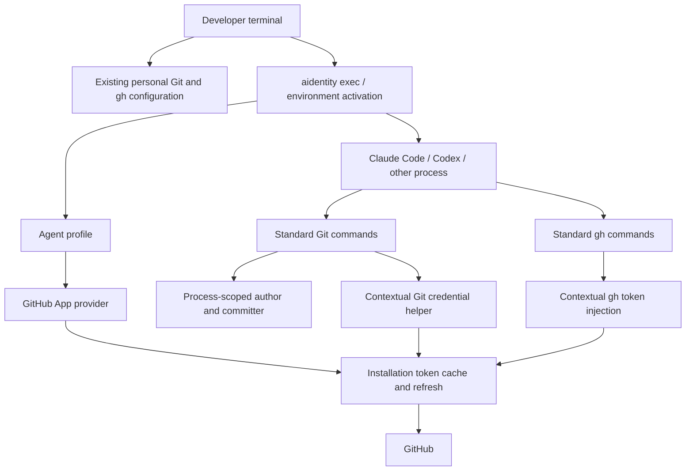

# Product Brief — aidentity

> **Status:** Draft / product discovery  
> **Working name:** `aidentity` (alternative: `agent-id`)  
> **Initial platform:** GitHub  
> **Product category:** AI agent identity and credential runtime for software development

## 1. Executive summary

AI coding agents increasingly commit code, open pull requests, review changes and perform repository operations. Yet, when running locally, they typically inherit the developer's Git identity and GitHub credentials. This makes agent activity indistinguishable from human activity and grants agents access that may exceed their actual responsibilities.

**aidentity gives AI agents their own operational identity, without changing how developers or agents use Git and GitHub.**

A developer continues using their personal account in their terminal. Claude Code, Codex or another agent can run in the same repository under a dedicated GitHub App identity, with independent permissions and automatically refreshed installation credentials.

The product is a standalone CLI and local identity runtime. It may reuse or adapt technical foundations from GHAPP, but is not an extension, new mode or roadmap for that project. It has its own name, architecture, configuration, release lifecycle and product direction.

## 2. Problem

### Current experience

- Agents inherit personal Git author and committer settings.
- Git pushes, pull requests and comments can be attributed to the human account even when performed by an agent.
- Agents may inherit broad personal credentials instead of narrowly scoped access.
- Switching global Git configuration or `gh` accounts interrupts the developer's normal workflow and creates conflicts between concurrent sessions.
- Long-running agents need credentials that remain valid without manually refreshing tokens.
- Multiple agents acting in the same repository are difficult to distinguish or govern.

### Core insight

The identity should belong to the **agent's execution context**, not to the workstation, repository or human developer account.

A repository is a shared resource. The process performing an operation should determine which identity and credentials are used.

## 3. Product vision

Make AI agents first-class participants in software development, with explicit identities, independent permissions and attributable actions.

**One developer environment. Multiple agent identities. Standard developer tools.**

The product should eventually enable a developer or team to define who an agent is, what it can access and which credentials it receives, then run that agent without manually switching accounts or modifying repository-wide settings.

### Product principles

1. **Context over global state:** identity is activated for a process/session, not the entire machine.
2. **Native workflows:** agents use ordinary `git` and `gh` commands wherever possible.
3. **Explicit identity:** the active profile and credential source must be discoverable and understandable.
4. **Least privilege:** use provider-native, narrowly scoped credentials; do not silently fall back to human credentials in agent mode.
5. **Security by design:** separate attribution from actual credential isolation; do not claim security guarantees the runtime cannot enforce.
6. **GitHub first:** validate the product on GitHub before investing in cross-provider abstractions.

## 4. Target users

| User | Need |
| --- | --- |
| Individual developer using Claude Code or Codex | Keep personal GitHub activity separate from agent activity without disrupting local workflow. |
| Developer running multiple agents | Assign distinct identities to implementation, review and release agents. |
| Engineering team adopting AI coding agents | Attribute changes, limit agent permissions and standardize agent onboarding. |
| Automation/platform engineer | Provide repeatable, auditable agent execution environments without embedding personal credentials. |

**Initial customer:** a developer using GitHub and a local coding agent, who already has or is willing to create a GitHub App and wants a simple, reliable way to activate its identity.

## 5. Jobs to be done

- When I launch Claude Code, I want it to use a dedicated bot identity so that its commits and GitHub actions are distinguishable from mine.
- When I work in the same repository myself, I want my normal Git and GitHub credentials to continue working unchanged.
- When an agent session lasts several hours, I want its GitHub credentials refreshed automatically.
- When I run two agents concurrently, I want each to have its own identity and permissions.
- When an agent lacks valid credentials, I want its operation to fail rather than silently use my personal account.
- When debugging authentication, I want to see the active identity, provider, credential source and target repository without exposing secrets.

## 6. Product scope and positioning

### What aidentity is

A CLI and execution-context runtime that binds an agent profile to Git identity, Git transport credentials and GitHub API credentials.

### What aidentity is not

- An AI coding agent, model provider or orchestration framework.
- A replacement for Git, GitHub CLI or GitHub's authorization model.
- A general-purpose password manager or enterprise IAM platform.
- A security sandbox in its initial local-process implementation.
- A continuation or rebranding of GHAPP with the same product scope.

### Differentiation

Traditional credential helpers focus on authenticating a client to a Git host. aidentity focuses on **which actor is executing a development task**, and coordinates commit identity, transport authentication and API authentication around that actor.

## 7. Core user experience

The following CLI examples are proposed interfaces, not existing functionality.

### 7.1 Onboarding

```bash
# Configure a dedicated GitHub App identity
aidentity setup github --profile claude

# Check configuration and repository access
aidentity doctor --profile claude
```

Onboarding guides the user through providing a GitHub App ID, installation ID and private key reference. It resolves the bot login and numeric user ID, validates access to the intended repositories and stores configuration without changing global Git settings or personal `gh` authentication.

### 7.2 Explicit execution

```bash
aidentity exec --profile claude -- claude
aidentity exec --profile reviewer -- codex
aidentity exec --profile claude -- git push
```

Inside the agent session:

```bash
git commit -m "Implement feature"
git push
gh pr create
```

In the developer's normal terminal, these same commands retain the developer's identity.

### 7.3 Automatic Claude Code integration

```bash
aidentity env --profile claude --shell bash
```

A Claude Code `SessionStart` integration can load the generated environment into the session's shell commands using `CLAUDE_ENV_FILE`. Explicit execution remains the canonical activation mechanism; automatic activation is a convenience layer and must be tested for session startup, resume and nested execution.

### 7.4 Inspect the active identity

```bash
aidentity whoami
```

Example output:

```text
Context:       agent
Profile:       claude
Provider:      github.com
Identity:      claude-dev[bot]
Installation:  12345678
Credentials:   GitHub App installation token
Token status:  valid (expires in 42m)
```

Outside an activated context, report `personal/unmanaged` rather than claiming to know the developer's identity unless it has actually been resolved.

## 8. MVP requirements — GitHub only

| Requirement | Priority | Acceptance criteria |
| --- | --- | --- |
| GitHub App profile setup | P0 | Configure an existing App and installation, resolve bot identity, validate credentials; no global auth changes. |
| Process-scoped execution | P0 | `exec` activates a selected profile for a child process and descendants; parent terminal remains unchanged. |
| Git author and committer | P0 | New commits made through normal Git commands in agent mode use the configured bot name and email. |
| Git transport authentication | P0 | HTTPS Git operations use App credentials; common GitHub SSH remotes can be rewritten to HTTPS within the agent context. |
| GitHub CLI authentication | P0 | Ordinary `gh` invocations use the selected App token, refreshed when needed, without switching personal `gh` accounts. |
| Token lifecycle | P0 | Cache installation tokens by appropriate profile/installation/host and scope; refresh before expiry; never emit secrets in diagnostics. |
| Fail-closed default | P0 | Missing or invalid agent credentials produce an actionable error; supported GitHub operations do not silently fall back to personal credentials. |
| Diagnostics | P0 | `whoami` and `doctor` explain active profile, resolved identity, configuration conflicts and access failures without exposing tokens. |
| Claude Code integration | P0 | Document and test a SessionStart-based integration so normal Claude launches can activate an agent profile. |
| Multiple profiles | P1 | Two agent sessions can run concurrently with different GitHub App identities without cache or environment cross-contamination. |
| Codex and generic launchers | P1 | Document/test explicit execution for Codex and arbitrary subprocesses. |

### MVP boundaries

The MVP targets local macOS/Linux workflows with Bash/Zsh and GitHub.com. Windows, GitHub Enterprise Server, custom Git hosts, managed team deployment and other Git providers are deferred pending validation. These are proposed prioritization choices, not permanent exclusions.

## 9. Technical approach

### 9.1 Conceptual architecture



### 9.2 Components

| Component | Responsibility |
| --- | --- |
| CLI | Setup, profile selection, execution, environment generation and diagnostics. |
| Context runtime | Build the child environment, activate a profile and preserve process exit status/signals. |
| Profile store | Persist non-secret metadata and references to securely stored credentials. |
| GitHub provider | Resolve GitHub App bot identity, mint installation tokens and validate target access. |
| Token manager | Cache and refresh tokens safely across concurrent processes. |
| Git integration | Configure author/committer variables, transport settings and contextual credentials. |
| GitHub CLI integration | Inject a fresh `GH_TOKEN` for each supported invocation without persisting it in personal configuration. |

### 9.3 Git identity and credentials

Use process-scoped Git configuration (`GIT_CONFIG_COUNT`, `GIT_CONFIG_KEY_n`, `GIT_CONFIG_VALUE_n`) and author/committer environment variables. Preserve or explicitly handle inherited configuration rather than blindly replacing it. Configure credential helper ordering, GitHub URL rewriting and non-interactive authentication deliberately.

The GitHub credential helper must validate the requested protocol, host and repository scope where available. For repository-specific policies, enable appropriate path-aware credential handling and avoid granting or returning a token for an unrelated host. Account for existing helpers, URL rewrites, remote push URLs, HTTP authorization headers and shell configuration that could change effective behavior.

The `gh` wrapper should use a known executable and request a current installation token on each invocation. Explicitly handle conflicting inherited authentication variables and host selection. Prevent wrapper recursion and document commands that are incompatible with installation tokens.

Git author and committer metadata are independent from the authenticated GitHub actor. Do not treat matching commit metadata as cryptographic proof of origin. Disable inherited personal commit signing in agent mode unless an explicit agent signing configuration is available; do not claim that App-authenticated pushes automatically produce verified commits.

### 9.4 Profile configuration (illustrative)

```yaml
version: 1

profiles:
  claude:
    provider: github
    host: github.com
    app_id: 123456
    installation_id: 789012
    private_key: keyring:claude-github-app
    identity:
      name: claude-dev[bot]
      email: 12345678+claude-dev[bot]@users.noreply.github.com

  reviewer:
    provider: github
    host: github.com
    app_id: 456789
    installation_id: 987654
    private_key: keyring:reviewer-github-app

integrations:
  claude-code:
    profile: claude
    activation: session-start
```

The actual schema, keyring support and profile-selection UX are design decisions to validate. Identity fields should normally be resolved from the provider and cached, rather than requiring manual entry.

## 10. Security and trust model

### MVP guarantees and limitations

- The runtime controls identity and credentials for its supported execution paths.
- Personal global Git and `gh` configuration are not modified by setup or execution.
- Agent-mode authentication fails closed when supported credential acquisition fails.
- GitHub App permissions and installation repository access remain the authoritative server-side controls.
- A local agent running as the developer's OS user is **not isolated** from other files, SSH agents, personal tokens or executables accessible to that user. It may bypass wrappers or remove environment variables. This is not a security boundary.

### Credential handling

Use OS keyring or a protected private-key file as a local credential source. Installation tokens are sensitive bearer credentials, normally valid for one hour. Cache them with restrictive permissions, refresh ahead of expiry and avoid exposing them through logs, command output, shell tracing or configuration dumps. Test cache locking and atomic writes.

A GitHub App private key can mint installation tokens for that App's installations; it has a larger potential blast radius than an individual installation token. Restrict access and document rotation and revocation procedures.

### Future hardened mode

Separate the token broker from the agent runtime. Run the agent under a separate OS identity or sandbox/container with no access to personal credentials or the App private key. Broker only narrowly scoped, short-lived installation tokens and enforce repository and operation policies where technically possible.

This is a distinct security milestone, not a guarantee delivered by the MVP.

## 11. Example future team workflow

| Actor | Responsibility | Example permissions |
| --- | --- | --- |
| `claude-dev[bot]` | Implement changes and open PRs | Contents write, Pull requests write |
| `codex-reviewer[bot]` | Review changes and submit feedback | Contents read, Pull requests write |
| Human developer | Review, approve and merge | Existing human permissions, subject to branch protection |
| `release-agent[bot]` | Prepare releases and changelogs | Appropriate repository release/content permissions |

Separate GitHub Apps are required for distinct App bot identities; multiple installations of the same App do not create different bot accounts. Permissions above are illustrative and must be validated against actual operations and GitHub repository rules. Human approval requirements and branch protection should remain authoritative; agents should not receive bypass privileges by default.

## 12. Success metrics and validation

These are proposed MVP acceptance targets, not measured results.

| Metric | Initial target / validation |
| --- | --- |
| Time to first successful agent operation | Under 5 minutes after an existing GitHub App and key are available. |
| Identity correctness | 100% of supported test commits have expected author/committer; test PRs/comments/push events have the intended App actor where observable. |
| Human workflow preservation | No persistent changes to personal Git/gh configuration; normal human operations continue after agent exit. |
| Token reliability | Successful supported operations across a token expiry/refresh cycle without manual intervention. |
| Fail-closed behavior | All tested missing-token, invalid-token and permission-denial scenarios avoid personal credential fallback. |
| Profile isolation | Concurrent sessions with different Apps do not mix author identities, credentials or caches. |
| Adoption signal | Pilot users repeatedly launch agents through the runtime and prefer it to manual account switching. |

### First validation scenario

Use a disposable GitHub repository with a developer account and a dedicated App. Run a human terminal and Claude Code session concurrently. Create separate commits and branches, push as each actor, create a PR as the bot and inspect GitHub attribution. Repeat after token expiry, with invalid App credentials, and with two independent profiles. Verify that personal configuration is unchanged and that no secret appears in diagnostics.

## 13. Roadmap

### Phase 0 — Standalone foundation

Establish the independent project, name, module path, configuration layout, tests and release pipeline. Audit reusable GHAPP code and retain required license/copyright notices. Define which code is reused versus rewritten; do not introduce a runtime dependency on GHAPP or require its installation.

### Phase 1 — GitHub identity MVP

Implement one App profile, process-scoped activation, Git identity, Git credential integration, `gh` integration, token cache/refresh and diagnostics. Deliver Claude Code integration and end-to-end validation against a disposable repository.

### Phase 2 — Multi-agent identities

Add first-class named profiles, concurrent sessions, role-oriented onboarding and documented Codex/generic agent integrations. Support profile-specific permissions and repository selection within the provider's capabilities.

### Phase 3 — Hardened runtime

Introduce a separate credential broker, stronger credential isolation, policy controls and structured audit events. Validate sandbox/container deployment and revocation behavior.

### Phase 4 — Provider expansion (optional)

Evaluate GitLab, Bitbucket, Azure DevOps or other providers only if user demand justifies it. Preserve the shared execution-context model, but account for different provider identity and token semantics. Do not let hypothetical cross-provider requirements complicate the GitHub MVP.

## 14. Risks and open decisions

| Risk / question | Proposed direction |
| --- | --- |
| Name: `aidentity` vs `agent-id` | Use `aidentity` as the working name; check package, domain and trademark availability before public launch. |
| Code provenance and licensing | Inspect the exact source revision and license obligations before reuse; retain attribution and required notices. |
| Personal credential leakage | Treat local mode as convenience/attribution, not containment; prioritize hardened isolation separately. |
| Git configuration precedence and wrapper bypass | Test realistic inherited configs, shell startup behavior and remotes; document supported paths and known bypasses. |
| GitHub CLI compatibility | Identify installation-token-compatible commands and return clear errors for unsupported user-centric operations. |
| Commit verification | Decide whether agent-specific signing is a later feature; keep metadata attribution separate from verified signatures. |
| Profile selection | Start with explicit `exec`; add context auto-detection only with deterministic precedence and clear diagnostics. |
| GitHub App onboarding friction | Start with existing Apps, then evaluate guided registration or manifest-based setup. |
| Distribution and commercial model | Independent open-source CLI is a plausible starting hypothesis; licensing, hosting and monetization remain undecided. |

## 15. Product north star

**An AI agent should never need to impersonate its developer to participate in software development.**

The first release succeeds when a developer can launch Claude Code in an existing GitHub repository, watch it commit and open a pull request as its own bot, and continue working in the same repository as themselves — without switching accounts, changing global configuration or manually refreshing credentials.
